# Gemini Enterprise GCP Console 전체 설정 항목 Reference Guide

> **범용 관리자 Reference Guide (Project 전역 설정 + 개별 App 설정 전수 해설)**  
> 본 문서는 **Google Cloud Console**의 **Gemini Enterprise** 화면에 노출되는 모든 메뉴와 설정 항목을 **Part A (`Project` · `Location` 전역 설정)** 와 **Part B (개별 `App` 수준 설정)** 두 계층으로 나누어, 실제 `Console` `Capture` 이미지와 함께 항목별 기능·기본값·실무 권장값·주의사항을 정리한 범용 운영 지침서입니다.  
> 모든 화면은 실제 `Google Cloud Console`을 촬영한 뒤 `Project ID`·`App ID`·계정 식별자만 일반 예시(`corp-ai-platform-prod`, `corp-ge-prod-app`, `example-corp.com`)로 일반화했습니다.

---

## 0. 설정 계층 구조 한눈에 보기 (`Project` 전역 vs. 개별 `App`)

`Gemini Enterprise` 관리 화면은 **어느 계층에서 설정이 적용되는지**를 구분하는 것이 가장 중요합니다. `Authentication`, `CMEK`, `AI developer tools`, `Gemini Notebook` 보안 정책처럼 **`Project` + `Location` 단위로 전체 `App`에 공통 적용되는 설정**과, `Feature Management`, `Assistant`, `Model Armor`, `Search UI`처럼 **개별 `App`마다 독립적으로 켜고 끌 수 있는 설정**이 명확히 나뉩니다.

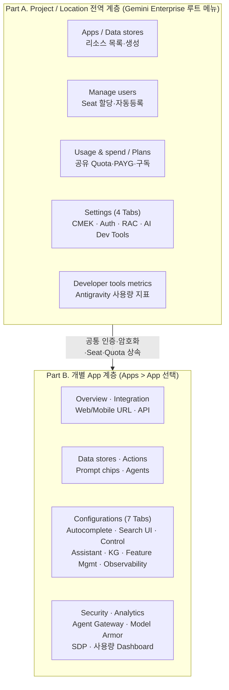

| 구분 | 적용 범위 (`Scope`) | 대표 설정 항목 | 운영 시 주의점 |
| :--- | :--- | :--- | :--- |
| **Part A. `Gemini Enterprise` 전역** | `Project` + `Location` (`global` / `us` / `eu`) 전체 | `Apps`, `Data stores`, `Manage users`, `Usage & spend`, `Developer tools metrics`, `Settings`(`CMEK`, `Authentication`, `Resource access control`, `AI developer tools`), `Plans & billing` | `Authentication`, `AI developer tools`, `Gemini Notebook` 보안은 동일 `Project` 내 모든 `App`에 공통 적용됨 |
| **Part B. 개별 `App` 설정** | 선택한 단일 `App` (`Engine`) 내부 | `Overview`, `Connected data stores`, `Actions`, `Prompt chips`, `Configurations` 7개 `Tab`, `Agents`, `Security`, `Integration`, `Analytics` | 운영 `App`과 검증(`Sandbox`) `App`을 분리해 신규 `Connector`·`Feature Toggle`·`Model Armor`를 선검증할 때 활용 |

---

# Part A. `Gemini Enterprise` 전역 (`Project` · `Location` 수준) 설정

좌측 `Gemini Enterprise` 루트 메뉴는 <strong><code>Project</code> 전체의 <code>App</code>·<code>Data Store</code> 자산 관리, <code>Seat</code> 라이선스, 공유 <code>Quota</code>, 전역 보안·인증(<code>Settings</code>)</strong>을 담당합니다.

---

## A-1. `Apps` (앱 목록 및 `Location` 관리)

동일 `Project`와 선택한 `Location`(`global`, `us`, `eu`)에 생성된 모든 `Gemini Enterprise` `App`을 조회하고 신규 `App`을 생성(`Create app`)하는 시작 화면입니다.

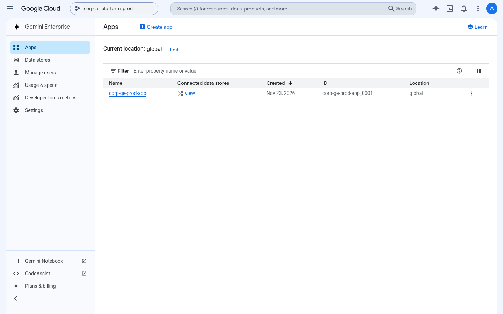

| UI 항목 | 기능 설명 | 실무 권장값 및 주의사항 (`Gotcha`) |
| :--- | :--- | :--- |
| **`Current location` (`Edit`)** | 조회 및 생성할 대상 `Location`(`global`, `us`, `eu`) 전환 | `App`과 `Data Store`는 생성 후 `Location` 변경이 불가능하므로 초기 설계 시 `Data Residency` 요건에 맞춰 고정 |
| **`Create app`** | 신규 `Gemini Enterprise` `App` 생성 | `Seat`는 `App`이 아니라 `Project`·`Location`의 `UserStore` 사용자 단위로 할당되므로, 같은 `Project` 내 검증용 `Sandbox App` 추가 생성 시 추가 `Seat` 비용 없음 |
| **`Name` / `ID` / `Location`** | `App` 표시명, 고유 `Engine ID`, 배포 `Location` | `REST API`·`Cloud Logging` 필터·`Support Case` 접수 시 `Engine ID`와 `Location`이 필수 식별자로 사용됨 |
| **`Connected data stores` (`view`)** | 해당 `App`에 연결된 `Data Store` 목록으로 바로 이동 | `App`별 지식 연결 범위를 분리할 때 확인 |

---

## A-2. `Data stores` (`Project` 수준 데이터 소스 저장소)

`Google Cloud Storage`, `BigQuery`, `Microsoft 365`, `Confluence`, `Jira`, `ServiceNow` 등 사내 데이터를 색인(`Ingestion`)하거나 실시간 연합 검색(`Federation`)하는 `Data Store`를 생성·관리합니다.

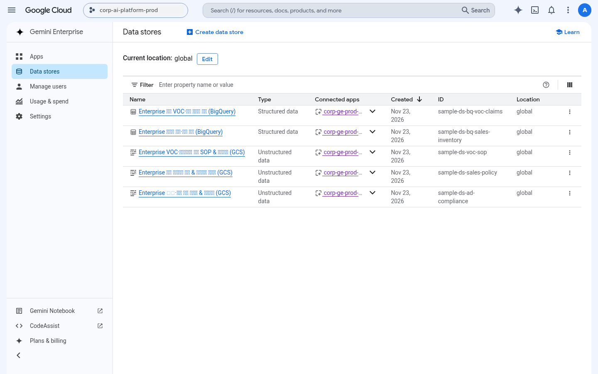

| UI 항목 | 기능 설명 | 실무 권장값 및 주의사항 (`Gotcha`) |
| :--- | :--- | :--- |
| **`Create data store`** | 신규 `1P` / `3P` `Connector` 또는 `GCS`/`BigQuery` `Data Store` 생성 | 색인형 `3P Connector` 사용 시 `Settings > Authentication`에서 `IdP` 설정이 선행되어야 원본 `ACL`이 정상 반영됨 |
| **`Type`** | `Structured data`(정형, `BigQuery` 등) vs. `Unstructured data`(비정형 문서, `PDF`/`DOCX` 등) 구분 | 문서 검색 품질을 높이려면 비정형 문서 `Data Store` 생성 시 `Layout Parser` 및 `Chunking` 옵션 검토 권장 |
| **`Connected apps`** | 해당 `Data Store`가 연결된 `App` 이름 표시 | 하나의 `Data Store`를 여러 `App`에 재사용할 수 있으나, 삭제 전 연결된 `App` 해제 필요 |

---

## A-3. `Manage users` (`Seat` 라이선스 할당 · 자동 등록 · 현황 추출)

`Location`별 `Gemini Enterprise` 구독(`Subscription`) 현황을 확인하고, 사용자별 `Seat`를 할당·회수하거나 전체 사용자 목록을 `CSV`로 내려받는 핵심 운영 화면입니다.

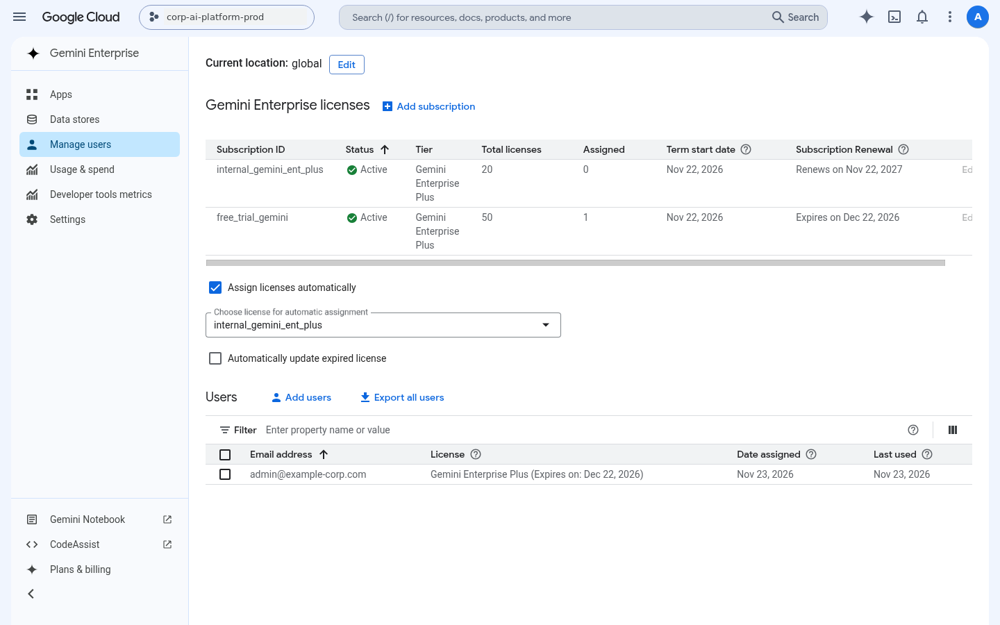

| UI 항목 | 기능 설명 | 기본값 (`Default`) | 실무 권장값 및 주의사항 (`Gotcha`) |
| :--- | :--- | :--- | :--- |
| **`Gemini Enterprise licenses` `Table`** | `Subscription ID`, `Status`, `Tier`(`Standard`/`Plus`), `Total licenses`, `Assigned`, 갱신/만료일 표시 | 구독 계약 기준 | `Edit`에서 `Seat` 증설 또는 갱신 조건 확인. 무료 체험(`free_trial_gemini`)과 유료 구독이 공존할 수 있음 |
| **`Assign licenses automatically`** | `IAM` 권한을 가진 사용자가 최초 로그인할 때 잔여 `Seat`를 자동 배정(`API Field`: `enableLicenseAutoRegister`) | 활성 가능 | 정원이 정해진 전사 운영 환경에서는 **`OFF` 권장** — 미승인 사용자의 `Seat` 선점을 막고 `CSV` 또는 `UserStore REST API`로 통제 |
| **`Choose license for automatic assignment`** | 자동 할당 `ON`일 때 어느 `Subscription ID`에서 `Seat`를 차감할지 지정 | 첫 구독 | 유료/체험 구독이 함께 있을 때 의도한 `Subscription`이 선택되었는지 반드시 확인 |
| **`Automatically update expired license`** | 만료된 `Seat`를 활성 구독으로 자동 승계할지 여부 | 선택 | 무료 체험에서 유료 구독 전환 시 서비스 중단 방지에 유용 |
| **`Users` 목록 (`Add` / `Delete` / `Export`)** | 개별/일괄 사용자 `Seat` 추가·회수 및 `lastLoginTime` 포함 `CSV` 내보내기 | 수동 관리 | 대규모 조직은 `UserStore REST API`(`userLicenses.list`, `batchUpdateUserLicenses`)로 자동화 연계 |

---

## A-4. `Usage & spend` (공유 `Quota` 풀 · `PAYG` 초과 과금 · 개인 상한)

동일 `Project`·`Location`·`Edition` 사용자 전체가 공유하는 `Storage` 및 기능별 `Quota` 소진율을 모니터링하고, 초과 사용(`Pay-as-you-go`)과 단일 사용자 상한(`Multiplier`)을 통제합니다.

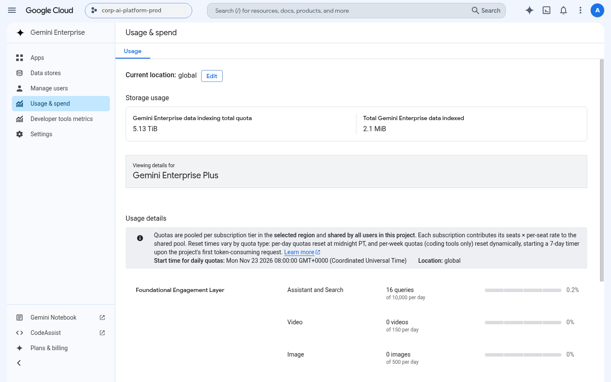

| UI 항목 | 기능 설명 | 실무 권장값 및 주의사항 (`Gotcha`) |
| :--- | :--- | :--- |
| **`Storage usage`** | `Data indexing total quota` 대비 현재 색인된 `Total data indexed` 용량 표시 (`Standard` 30 GiB/`Seat`, `Plus` 75 GiB/`Seat`, 전 `Edition` 합산 공유) | `Data Store` 확장 시 색인 용량 추이 정기 점검 |
| **`Viewing details for`** | 조회할 `Edition`(`Standard` / `Plus`) 선택 | `Feature Quota`는 `Edition`별로 별도 공유 `Pool`을 형성 |
| **`Foundational Engagement Layer`** | `Assistant and Search`(`Standard` 160 / `Plus` 200 `Queries`/일/`Seat`), `Video`, `Image`, `Deep research` 일일 공유 `Pool` 소진율 (매일 `00:00 PT` 초기화) | `500 Seats` `Standard` 기준 `Assistant`는 일 `80,000 Queries` 공유 `Pool` |
| **`1:1 Personal Agents` (`No-code Agents`)** | 일일 `No-code Agent` 생성 및 외부 `Agent` 등록 건수 소진율 (`Standard` 1 / `Plus` 10 `Agents`/일/`Seat`) | `ADK`·`A2A` 외부 `Agent` 등록도 1건으로 차감됨 |
| **`Coding Tools` (`Antigravity`)** | `Antigravity` · `Antigravity IDE` · `Android Studio` 합산 주간 `Credit` 공유 `Pool` (`Standard` 월 `$10` → 주 `$2.50`/`Seat`, `Plus` 월 `$15` → 주 `$3.75`/`Seat`) | 최초 `Token` 소비 시점부터 <strong>7일 동적 주기(<code>Rolling 7-day</code>)</strong>로 초기화되며 미사용분 이월 불가 |
| **`Pay-as-you-go usage above quota`** (하단 설정) | 공유 `Pool` 소진 후 종량제 초과 과금 허용 여부 | 예산 통제가 필요한 초기 운영 단계는 **`Disabled` 권장** (단, `3rd-party Model` 활성화 시에는 `PAYG` 활성화 필요) |
| **`Single-user quota limit` (`Multiplier`)** (하단 설정) | 소수 사용자의 전사 `Pool` 독점을 막기 위한 개인 상한 배수 (정수 `1` 이상, 기본 제안값 `10x`) | **`Enabled` + `Multiplier = 10` 권장** (예: `Standard` `Assistant` 1인 일 1,600 `Queries`, `Antigravity` 주 `$25` 상한) |

---

## A-5. `Developer tools metrics` (`Antigravity` · `IDE` 사용량 지표)

`AI developer tools`(`Antigravity`, `IDE Extension`, `Android Studio`)의 활성 사용자 수, 요청량, 추론 활동 등 개발 도구 전용 사용 지표를 확인하는 내장 `Dashboard`입니다.

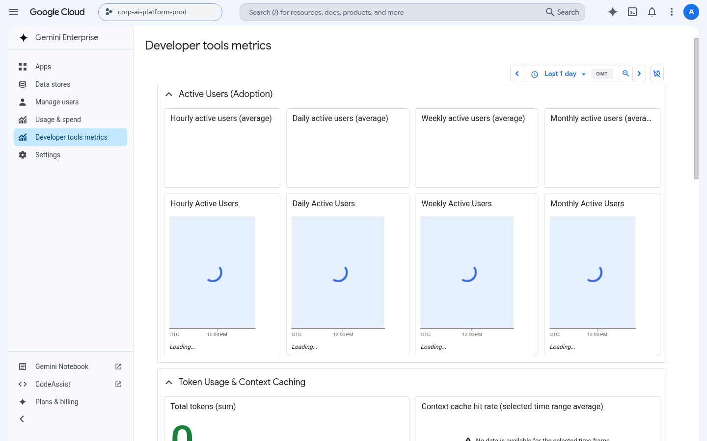

| UI 항목 | 기능 설명 | 실무 권장값 및 주의사항 (`Gotcha`) |
| :--- | :--- | :--- |
| **`Developer tools metrics` `Dashboard`** | `Antigravity` 계열 도구의 일별/주별 사용 추이 및 채택률 모니터링 | `Settings > AI developer tools > Compliance > Metadata logging = Enabled`를 켜야 상세 `Token`·사용자별 `Log Analytics` 분석까지 가능 |

---

## A-6. `Settings > CMEK` (고객 관리 암호화 키)

`Google Cloud KMS`에 보관된 고객 자체 암호화 키(`Customer-Managed Encryption Keys`)를 `Location`별로 연결해 저장 데이터(`Data at Rest`)를 암호화합니다.

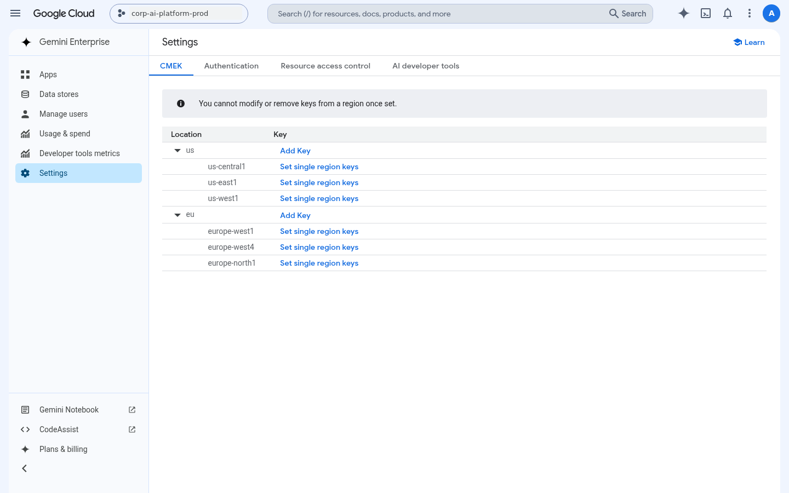

| UI 항목 | 기능 설명 | 실무 권장값 및 주의사항 (`Gotcha`) |
| :--- | :--- | :--- |
| **`Location` (`us`, `eu` 및 단일 `Region`)** | `Multi-region`(`us`, `eu`) 또는 하위 단일 `Region`(`us-central1`, `europe-west1` 등)별 `KMS Key` 등록 | **주의 (`Irreversible`)**: 화면 상단 경고대로 **`Region`에 `CMEK Key`를 한 번 등록하면 이후 수정하거나 제거할 수 없음**. 또한 `global` `Location`에는 `CMEK`가 지원되지 않고 `us`/`eu`에서만 지원됨 |

---

## A-7. `Settings > Authentication` (전역 사용자 인증 `IdP` 설정)

해당 `Project` 내 모든 검색·`Gemini Enterprise` `App`이 사용자 신원을 확인하고 문서 권한(`ACL`)을 적용할 때 사용할 `Identity Provider`를 `Location`별로 지정합니다.

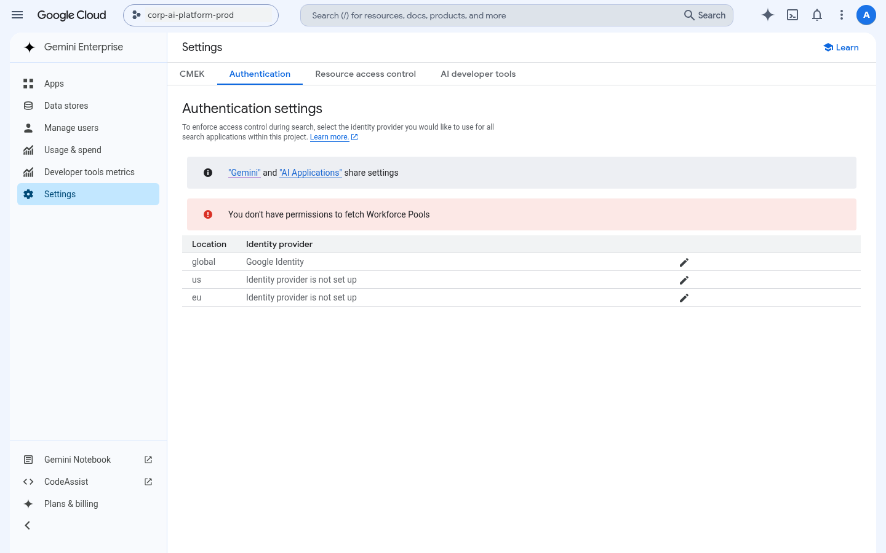

| UI 항목 | 기능 설명 | 실무 권장값 및 주의사항 (`Gotcha`) |
| :--- | :--- | :--- |
| **`Location`별 `Identity provider`** | `global`, `us`, `eu` 각 `Location`에 **`Google Identity`** (`Cloud Identity` / `Google Workspace`) 또는 **`Third-party identity provider` (`Workforce Identity Federation / WIF`)** 선택 | • **전역 공유 주의**: `Gemini Enterprise`와 `AI Applications`가 설정을 공유하며, 동일 `Project` + `Location`의 모든 `App`에 일괄 적용됨 • `Microsoft 365` 색인형(`Ingestion`) `Connector` 연동 시 `WIF` 구성이 필요하며, 그렇지 않은 `Non-GWS` 환경은 `Cloud Identity Free` + `3P SSO`가 표준 권장 • `WIF Pool` 목록 조회에는 `Organization` 수준 `Workforce Pool Viewer` 권한 필요 |

---

## A-8. `Settings > Resource access control` (`App` · `Data Store` 단위 세분화 접근 제어)

`Project` 전체 `IAM` 대신 **개별 `App`, `Data Store`, `Data Connector` 리소스 단위로 사용자 접근 권한을 분리**하는 기능입니다.

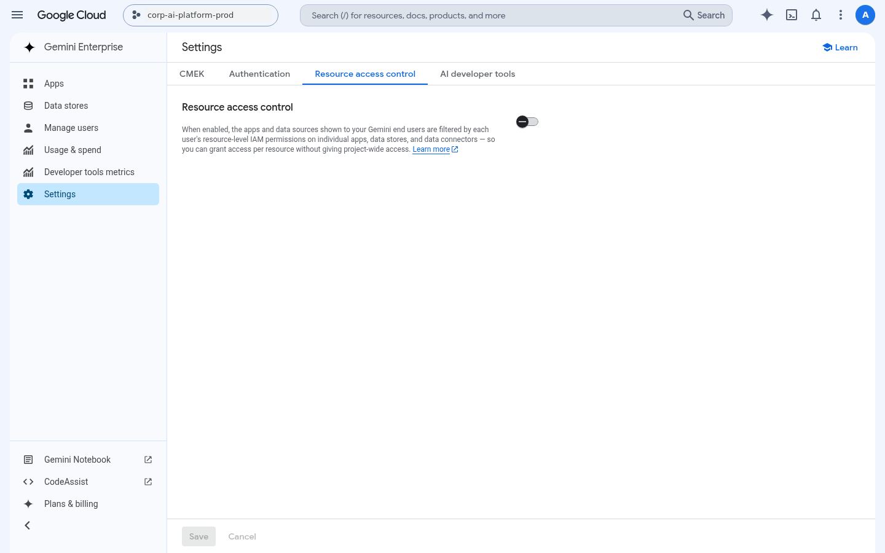

| UI 항목 | 기능 설명 | 기본값 (`Default`) | 실무 권장값 및 주의사항 (`Gotcha`) |
| :--- | :--- | :--- | :--- |
| **`Resource access control` `Toggle`** | 활성화 시 최종 사용자에게 노출되는 `App`과 데이터 소스를 각 사용자의 리소스 단위 `IAM` 권한에 따라 필터링 | `Disabled` | 동일 `Project` 안에 **운영 `App 1`(전사 임직원)과 검증 `App 2`(관리자 전용)** 를 함께 두고 일반 사용자의 `App 2` 접근을 확실히 차단하려면 **`Enabled` 활성화 + `App` 단위 `IAM` 부여** 권장 |

---

## A-9. `Settings > AI developer tools` (`Antigravity` 보안 · 감사 · 기능 · 모델 정책)

`Google Antigravity`, `Antigravity CLI`, `IDE Extension`, `Android Studio` 등 `AI developer tools` 전체에 공통 적용되는 `Project` + `Location` 전역 보안·컴플라이언스·모델 정책입니다.

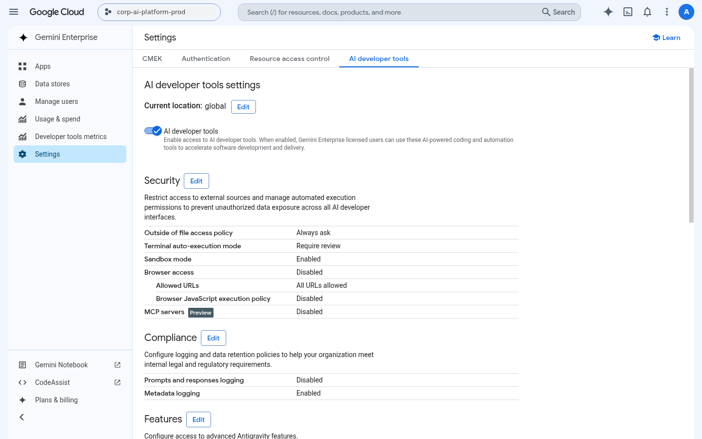

| 섹션 | UI 항목 | 기능 설명 | 실무 권장값 및 주의사항 (`Gotcha`) |
| :--- | :--- | :--- | :--- |
| **전역 스위치** | **`AI developer tools` `Toggle`** | `Licensed` 사용자의 `Antigravity` 계열 도구 사용 허용 여부 | `ON`으로 켜더라도 일반 임직원 `Group`에는 `businessaicode.*` 권한을 제외한 `Custom IAM Role`을 부여해 개발자만 사용하도록 분리 가능 |
| **`Security`** | **`Outside of file access policy`** | 작업 `Workspace` 폴더 외부의 로컬 `File` 읽기/쓰기 정책 (`Allow` / `Always ask` / `Deny`) | 보안 민감 환경은 **`Deny`** 또는 **`Always ask`** 권장 |
| **`Security`** | **`Terminal auto-execution mode`** | `Agent`의 로컬 `Terminal` 명령 자동 실행 여부 (`Always proceed` / `Require review` / `Deny`) | 초기 기본값(`Always proceed`) 그대로 두지 말고 **`Require review` 권장** |
| **`Security`** | **`Sandbox mode`** | 명령 실행을 격리 `Sandbox` 내부로 제한할지 여부 | **`Enabled` 권장** |
| **`Security`** | **`Browser access` / `Allowed URLs` / `JavaScript execution policy`** | `Agent`의 내장 `Browser` 제어 허용 여부, 허용 `URL` 패턴, `JavaScript` 실행 허용 여부 | 사내 보안 정책에 따라 초기 **`Disabled`** 유지 후 필요 시 사내 허용 도메인만 `Allowlist` 지정 |
| **`Security`** | **`MCP servers` (`Preview`)** | 외부 `MCP` 서버 연결 허용 여부 및 `Allowlist` 통제 | 초기 **`Disabled`** 또는 승인된 사내 `MCP` 서버만 `Allowlist`로 제한 |
| **`Compliance`** | **`Prompts and responses logging`** | 개발자 `Prompt` 원문과 `Model` 응답 본문을 `Cloud Logging`에 저장할지 여부 | 소스코드 원문 저장 시 보안·개인정보 보관 정책 검토 후 결정 (초기 **`Disabled`** 권장) |
| **`Compliance`** | **`Metadata logging`** | `Prompt` 본문 없이 사용자·모델·`Token` 수·시각 등 메타데이터(`businessaicode.googleapis.com/inference_response`)만 기록 | **`Enabled` 강력 권장** — 30일 미사용 `Seat` 회수 및 부서별 `Token` 사용량 분석의 필수 근거 |
| **`Features`** | **`/boost command` / `/teamwork command`** | `Antigravity` 고급 명령(`/boost`, `/teamwork` 및 `/swarm`) 허용 여부 | 조직 정책 및 `Credit` 소진 속도를 고려해 단계적 활성화 |
| **`Model availability`** | **`Google models` / `Non-Google models`** | `Antigravity`에서 선택 가능한 `Google` 공식 모델 및 `3rd-party` 모델(`Anthropic` 등) 허용 목록 | `Non-Google models` 활성화 시 `Usage & spend`에서 **`PAYG` 활성화**가 필요하며 별도 종량제 요금이 과금되므로 `Cloud Billing` 예산 알림 필수 설정 |

---

## A-10. `Plans & billing` 및 `Gemini Notebook` (`NotebookLM Enterprise`)

좌측 하단 메뉴에서 `Gemini Enterprise` 구독 플랜(`Plans & billing`)을 관리하고, `Gemini Notebook`(`NotebookLM Enterprise`) 콘솔로 이동합니다.

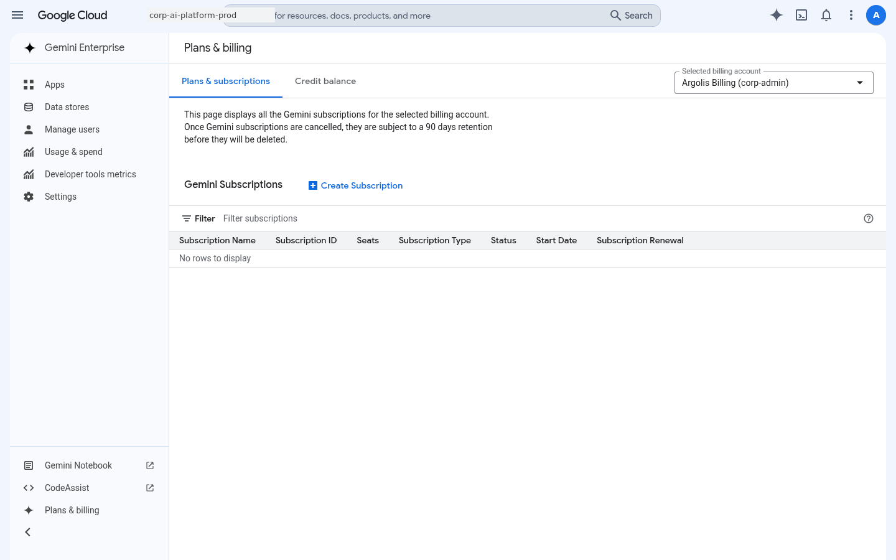

| UI 항목 | 기능 설명 | 실무 권장값 및 주의사항 (`Gotcha`) |
| :--- | :--- | :--- |
| **`Plans & billing`** | `Location`별 활성 구독(`Standard` / `Plus` / `Pay-as-you-go`), `Seat` 수량, 결제 계정(`Billing Account`) 연결 상태 확인 및 구독 추가 | `AI developer tools`(`Antigravity`)는 업그레이드된 셀프서브 또는 인보이스 결제 계정(`Invoiced Billing Account`)에서만 정식 제공됨 |
| **`Gemini Notebook`** (외부 링크 아이콘) | `NotebookLM Enterprise` 관리 화면으로 이동 | `Gemini Notebook`의 `Model Armor` 및 `SDP` 설정은 개별 `App`이 아니라 **`Project` 전체 `App`에 공통 적용**됨 |

---

# Part B. 개별 `App` 수준 (`Apps > [App 선택]`) 전체 설정

`Apps` 목록에서 특정 `App`을 클릭해 들어가면 해당 `App` 전용 좌측 메뉴(**`Overview`, `Connected data stores`, `Actions`, `Prompt chips`, `Configurations` 7개 `Tab`, `Agents`, `Security`, `Integration`, `Analytics`**)가 표시됩니다.

---

## B-1. `Overview` (`Dashboard`)

선택한 `App`의 `Web App` 및 `Mobile App` 접속 `URL`을 확인·복사하고, `Go to Gemini` 버튼으로 최종 사용자 화면을 즉시 열어볼 수 있는 대시보드입니다.

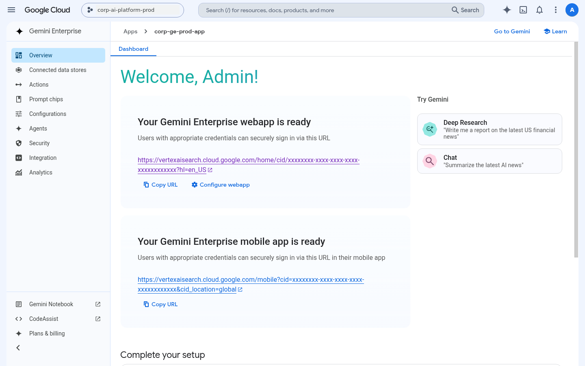

| UI 항목 | 기능 설명 | 실무 권장값 및 주의사항 (`Gotcha`) |
| :--- | :--- | :--- |
| **`Your Gemini Enterprise webapp is ready`** | 임직원에게 배포할 고유 `Web App URL` (`https://vertexaisearch.cloud.google.com/home/cid/...`) 및 `Copy URL` | 사내 포털·북마크·SSO 타일에 배포하는 최종 진입 주소 |
| **`Your Gemini Enterprise mobile app is ready`** | 모바일 앱 접속용 고유 `URL` | 모바일 앱 사용을 허용하지 않을 경우 `Configurations > Feature Management > Enable mobile app access = OFF`로 숨김 가능 |
| **`Go to Gemini`** (우측 상단) | 현재 로그인한 관리자 계정으로 `Web App` 새 탭 실행 | 설정 변경 직후 실제 사용자 UI 반영 여부를 검증할 때 사용 |

---

## B-2. `Connected data stores` (연결된 데이터 소스)

현재 `App`의 검색 및 `Assistant` 답변 근거(`Grounding`)로 연결된 `Data Store` 목록을 조회하고 신규 연결·해제를 관리합니다.

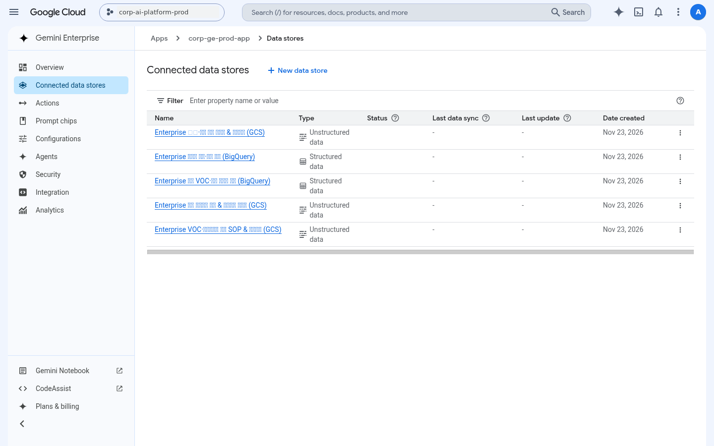

| UI 항목 | 기능 설명 | 실무 권장값 및 주의사항 (`Gotcha`) |
| :--- | :--- | :--- |
| **`Connected data stores` 목록** | 이 `App`에 바인딩된 `Data Store` 이름, 유형(`Structured` / `Unstructured`), 상태 표시 | 신규 `Data Store`는 먼저 검증용 `Sandbox App`에 연결해 `ACL`·검색 품질을 확인한 뒤 운영 `App`에 연결 권장 |

---

## B-3. `Actions` (외부 시스템 실행 `Action Connector`)

단순 조회(`Search`)를 넘어 `Jira` 티켓 생성, `ServiceNow` 요청 등록, `Calendar` 일정 생성 등 외부 업무 시스템에 쓰기/실행 작업을 수행하는 `Action`을 연결합니다.

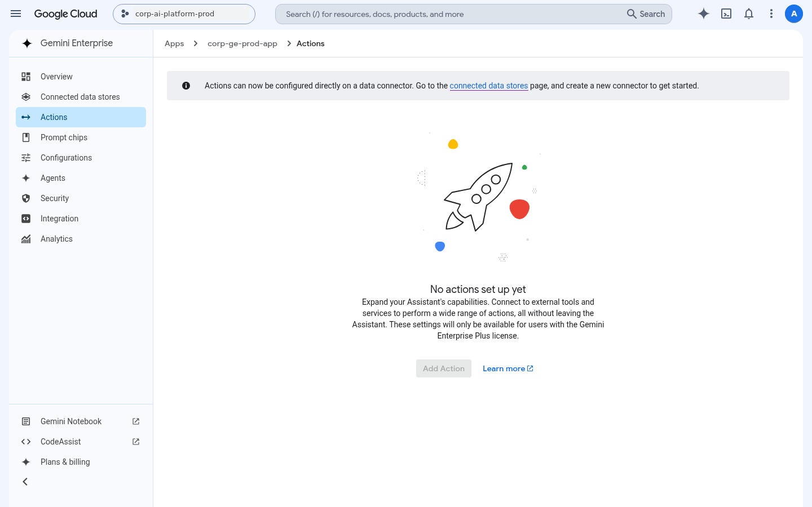

| UI 항목 | 기능 설명 | 실무 권장값 및 주의사항 (`Gotcha`) |
| :--- | :--- | :--- |
| **`Actions` 목록 / 추가** | 외부 SaaS 또는 사내 API와 연동된 `Action` 정의 및 활성화 관리 | 쓰기 권한이 수반되므로 사용자별 `OAuth` 위임(`3-legged OAuth`) 및 사전 승인 확인 흐름 검증 필수 |

---

## B-4. `Prompt chips` (홈 화면 추천 프롬프트 버튼)

`Web App` 첫 화면에 노출되어 임직원이 클릭 한 번으로 자주 쓰는 업무 질문이나 워크플로우를 실행할 수 있게 돕는 `Prompt Chip`을 구성합니다.

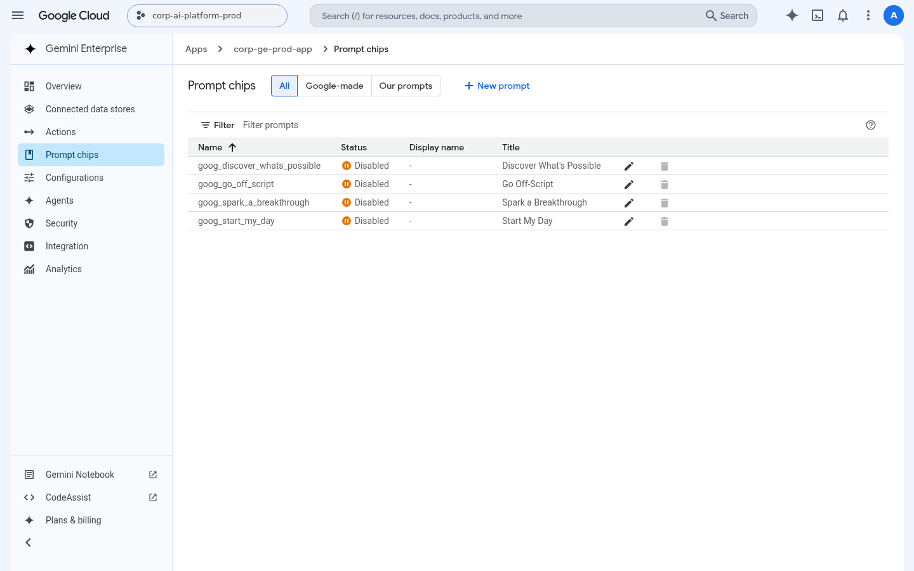

| UI 항목 | 기능 설명 | 실무 권장값 및 주의사항 (`Gotcha`) |
| :--- | :--- | :--- |
| **`Prompt chips` 생성·정렬** | 제목, 실행 `Prompt` 문구, 대상 `Agent` 또는 데이터 범위를 지정한 바로가기 칩 등록 | 초기 전사 오픈 시 사내 규정 질의·보고서 초안·번역 등 대표 유스케이스 3~5개를 배치하면 초기 채택률 향상에 효과적 |

---

## B-5. `Configurations > Autocomplete` (검색어 자동완성)

사용자가 검색창에 질문을 입력할 때 표시되는 자동완성 제안의 개수, 최소 글자 수, 매칭 방식, 활성화 시점을 제어합니다.

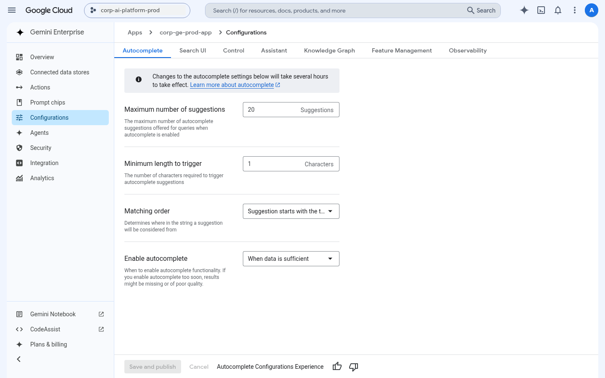

| UI 항목 | 기능 설명 | 기본값 (`Default`) | 실무 권장값 및 주의사항 (`Gotcha`) |
| :--- | :--- | :--- | :--- |
| **`Maximum number of suggestions`** | 자동완성 드롭다운에 표시할 최대 제안 개수 | 5 | 5~7개 권장 (너무 많으면 가독성 저하) |
| **`Minimum length to trigger`** | 자동완성이 동작하기 시작하는 최소 입력 글자 수 | 2~3 | 한국어 환경은 `2`글자 권장 |
| **`Matching order`** | 제안 문자열 매칭 기준 (`Suggestion starts with the term` 등) | 접두사 일치 | 일반 사내 검색은 기본값 유지 |
| **`Enable autocomplete`** | 자동완성 활성화 조건 (`When data is sufficient` / 즉시 등) | `When data is sufficient` | **주의**: 설정 변경 후 반영까지 **수 시간(`several hours`)** 소요됨 |

---

## B-6. `Configurations > Search UI` (검색 화면 · 브랜딩 · 바로가기)

`Web App`과 임베디드 `Widget`의 UI 동작, 사용자 피드백, 로고 브랜딩, 홈 화면 고정 바로가기(`Pinned Links`)를 설정합니다.

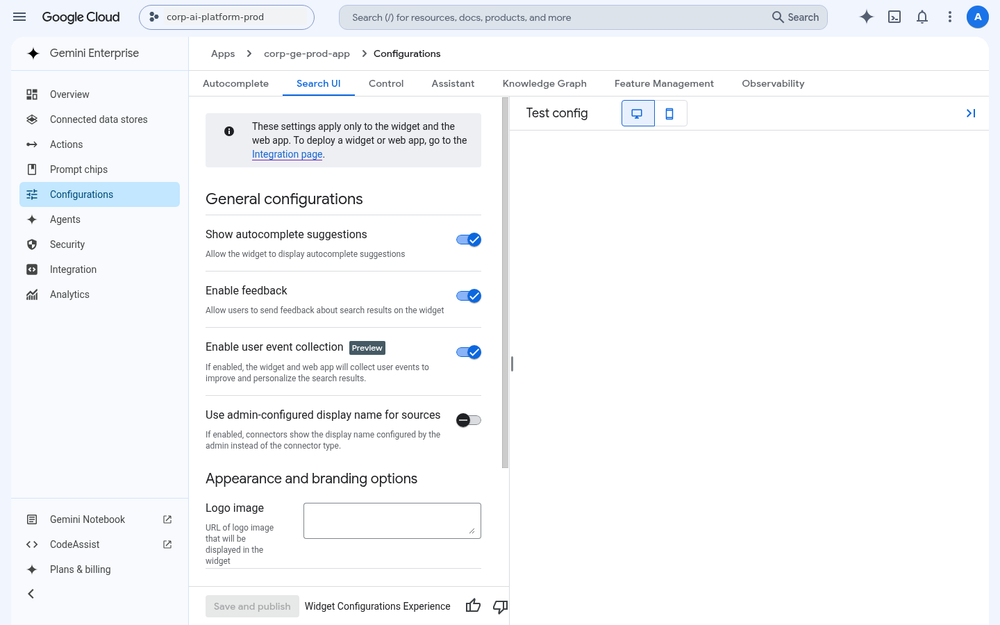

| 섹션 | UI 항목 | 기능 설명 | 실무 권장값 및 주의사항 (`Gotcha`) |
| :--- | :--- | :--- | :--- |
| **`General configurations`** | **`Show autocomplete suggestions`** | `Web App` / `Widget`에서 자동완성 제안 노출 여부 | `Enabled` 권장 |
| **`General configurations`** | **`Enable feedback`** | 검색 결과에 대한 사용자 좋아요/싫어요 피드백 수집 여부 | 초기 품질 개선을 위해 `Enabled` 권장 |
| **`General configurations`** | **`Enable user event collection` (`Preview`)** | 검색 클릭·상호작용 이벤트를 수집해 결과 개인화·품질 향상에 활용 | 사내 개인정보 처리방침 검토 후 결정 |
| **`General configurations`** | **`Use admin-configured display name for sources`** | 출처 배지에 커넥터 유형명 대신 관리자가 지정한 표시명 사용 | **`Enabled` 권장** — 사용자가 사내 시스템 이름으로 직관적으로 출처 식별 가능 |
| **`Appearance and branding`** | **`Logo image`** | `Web App` / `Widget`에 표시할 기업 로고 이미지 `URL` | 공개 접근 가능한 `HTTPS` 로고 `URL` 또는 사내 허용 경로 지정 |
| **`Appearance and branding`** | **`Pinned Links / Shortcuts`** | 홈 화면 상단에 아이콘과 함께 고정할 사내 포털·가이드 링크 (`Add shortcut`) | 사내 AI 이용 가이드라인, 헬프데스크 링크 배치 권장 |
| **`Data display options`** | **`Select data store`** | 특정 `Data Store`의 검색 결과 카드 표시 필드(제목·요약·링크 등) 커스터마이징 | 정형(`BigQuery`) 데이터 연결 시 주요 컬럼 매핑 필수 |

---

## B-7. `Configurations > Control` (검색 제어 규칙 `Serving Controls`)

특정 키워드 검색 시 동의어 확장(`Synonyms`), 특정 문서 상단 고정(`Boost` / `Promote`)·하향(`Bury`), 필터(`Filter`), 리다이렉트(`Redirect`) 등 검색 랭킹 규칙을 수동 제어합니다.

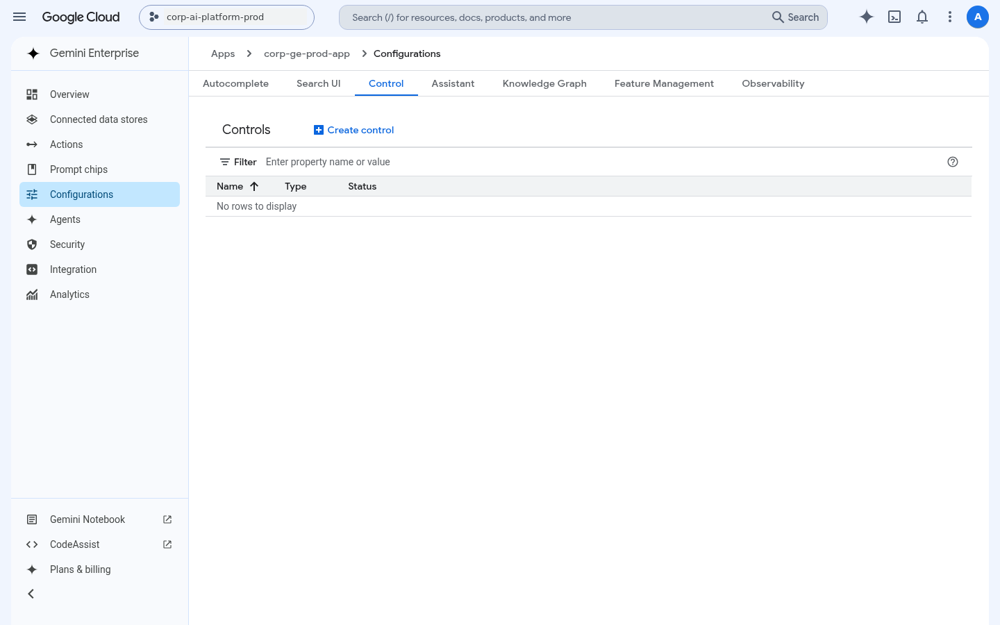

| UI 항목 | 기능 설명 | 실무 권장값 및 주의사항 (`Gotcha`) |
| :--- | :--- | :--- |
| **`Create control`** | 동의어, 부스트/버리, 리다이렉트, 필터 규칙 생성 | 사내 약어(예: 사내 부서·복리후생 약칭)나 필독 공지 문서를 최상단에 고정할 때 유용 |

---

## B-8. `Configurations > Assistant` (어시스턴트 지침 · 웹 그라운딩 · `Model Armor` · 보존 기간)

`Gemini Enterprise` 대화형 `Assistant`의 핵심 동작—시스템 지침, 웹 검색(`Web Grounding`), `Model Armor` 연동, `Knowledge Catalog`, 금지어, 대화 이력 보존 기간—을 설정합니다.

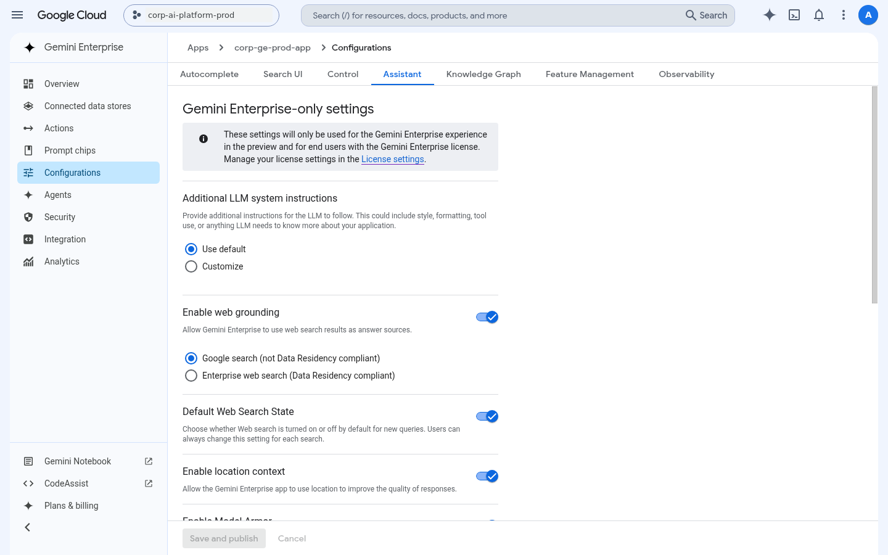

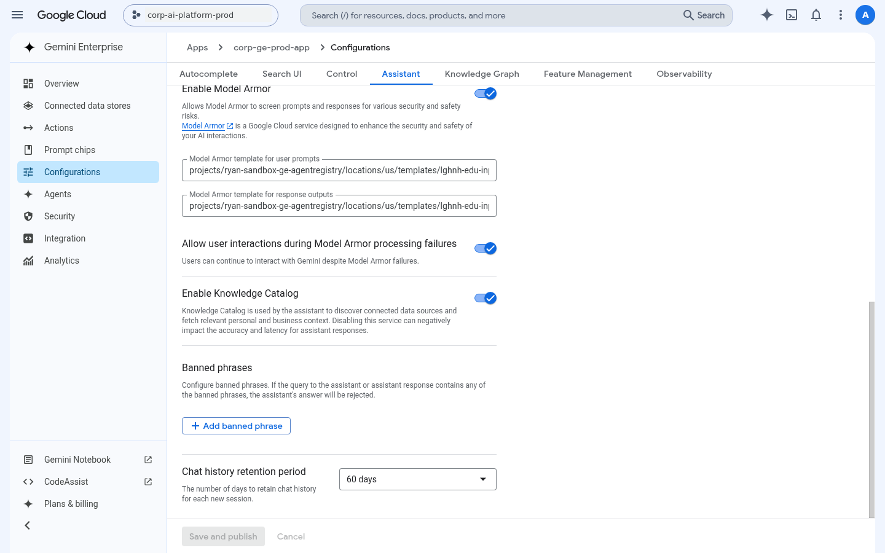

| UI 항목 | 기능 설명 | 기본값 (`Default`) | 실무 권장값 및 주의사항 (`Gotcha`) |
| :--- | :--- | :--- | :--- |
| **`Additional LLM system instructions`** | `Assistant`의 답변 어조, 형식, 언어, 준수 규칙 등 추가 `System Prompt` (`Use default` / `Customize`) | `Use default` | 사내 표준 답변 형식(예: 한국어 답변 기본, 출처 명시)이 필요할 때 `Customize` 활용 |
| **`Enable web grounding`** | 답변 생성 시 공개 웹 검색 결과를 근거로 활용할지 여부 (`Google search` vs. `Enterprise web search`) | 선택 | **`Data Residency` 준수가 필요하면 반드시 `Enterprise web search (Data Residency compliant)` 선택** (`Google search`는 `Data Residency` 미준수) |
| **`Default Web Search State`** | 새 대화 시작 시 웹 검색 버튼의 기본 `ON`/`OFF` 상태 (사용자가 질문마다 변경 가능) | 선택 | 사내 문서 중심 질의가 많으면 기본 `OFF`, 최신 시장 조사 중심이면 `ON` 권장 |
| **`Enable location context`** | 응답 품질 향상을 위해 사용자 위치 컨텍스트 사용 여부 | 선택 | 지역 기반 검색이 필요할 때만 활성화 |
| **`Enable Model Armor`** | 사용자 `Prompt`와 `Model` 응답을 `Model Armor`로 실시간 검사해 `PII`·유해 콘텐츠·`Prompt Injection` 차단 | `Disabled` | **`Enabled` 권장** — **`User prompt template`** 과 **`Response template`** 을 분리해 출력용에는 `Prompt Injection` 검사를 끄는 2-`Template` 구성 권장 (`locations/us` 또는 `eu` `Template` 사용) |
| **`Allow user interactions during Model Armor processing failures`** | `Model Armor` 서비스 장애 시 대화를 계속 허용할지(`Fail-open`) 차단할지(`Fail-close`) 결정 | `OFF` / 선택 | 가용성 우선이면 `ON`, 보안 최우선(금융·규제)이면 `OFF` |
| **`Enable Knowledge Catalog`** | 연결된 데이터 소스를 자동 탐색하고 개인·업무 컨텍스트를 가져오는 서비스 | `Enabled` | 비활성화 시 `Assistant` 정확도와 지연 시간(`Latency`)이 저하될 수 있으므로 **`Enabled` 유지 권장** |
| **`Banned phrases`** | 사용자 질문 또는 `Assistant` 응답에 포함되면 답변을 즉시 거부할 금지 문구 등록 | 없음 | 사내 프로젝트 코드명·대외비 키워드 등 명시적 차단어 등록에 활용 |
| **`Chat history retention period`** | 새 `Session`의 대화 이력을 보관하는 일수 | `60 days` | 사내 정보보호·감사 보관 주기에 맞춰 조정 |

---

## B-9. `Configurations > Knowledge Graph` (지식 그래프)

조직 내 인물·부서·프로젝트·문서 간 엔티티 관계를 이해해 검색 및 `Assistant` 응답의 문맥 정확도를 높이는 `Knowledge Graph` 설정입니다.

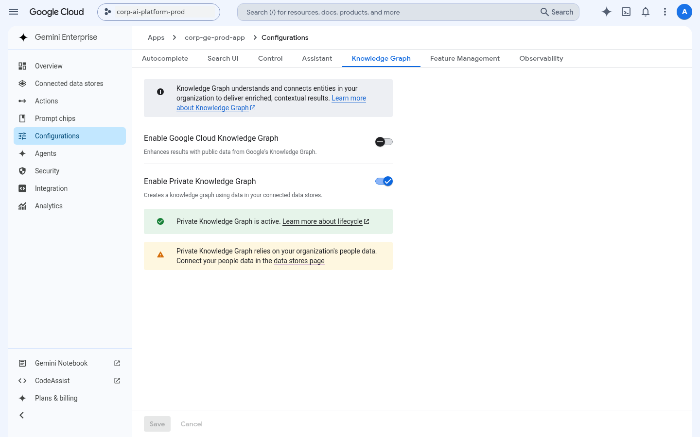

| UI 항목 | 기능 설명 | 실무 권장값 및 주의사항 (`Gotcha`) |
| :--- | :--- | :--- |
| **`Enable Google Cloud Knowledge Graph`** | Google 공개 `Knowledge Graph` 데이터로 일반 엔티티 검색 결과를 보강 | 일반 산업·기업명 검색 품질 향상에 유용 |
| **`Enable Private Knowledge Graph`** | 연결된 사내 `Data Store` 데이터로 기업 전용 `Knowledge Graph` 구축 | **주의**: `Private Knowledge Graph`는 조직의 **`People data`(임직원 디렉토리 데이터)** 에 의존하므로 `Data stores` 페이지에서 인물 데이터를 먼저 연결해야 정상 동작함 |

---

## B-10. `Configurations > Feature Management` (최종 사용자 기능 `Toggle` 및 모델 허용)

`License` 등급과 무관하게 **해당 `App`의 최종 사용자에게 어떤 기능을 노출하고 차단할지** 세밀하게 제어하는 핵심 화면입니다. (총 25개 기능 `Toggle` + `Model availability`)

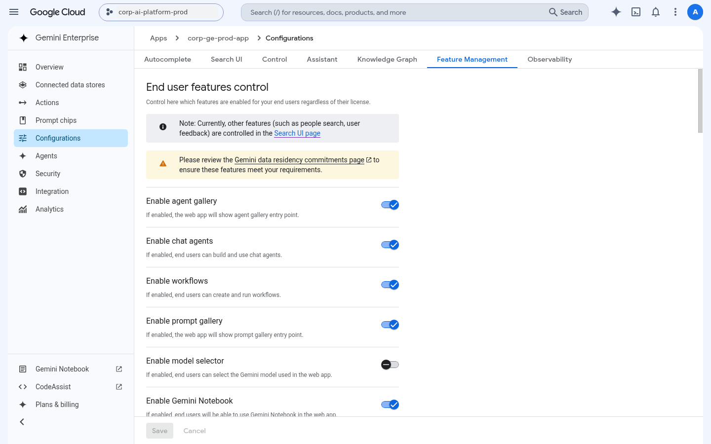

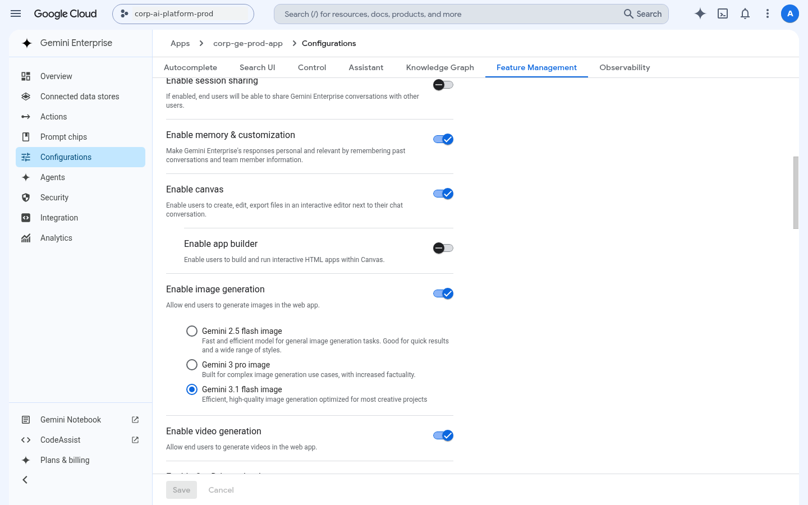

| 카테고리 | UI 항목 (`Toggle`) | 기능 설명 | 실무 권장값 및 주의사항 (`Gotcha`) |
| :--- | :--- | :--- | :--- |
| **에이전트 · 워크플로우** | **`Enable agent gallery`** | `Web App` 좌측에 `Agent Gallery` 진입점 표시 | 전사 표준 `Agent` 배포 시 `ON` |
| **에이전트 · 워크플로우** | **`Enable chat agents`** | 최종 사용자가 `No-code Chat Agent`를 직접 생성·사용 | 거버넌스 단계에 따라 파일럿 후 확대 권장 |
| **에이전트 · 워크플로우** | **`Enable workflows`** | 최종 사용자가 다단계 `Workflow`를 생성·실행 | 위와 동일 (`No-code Agents` 일일 `Quota` 차감) |
| **에이전트 · 워크플로우** | **`Enable prompt gallery`** | `Web App`에 `Prompt Gallery` 진입점 표시 | 사내 우수 `Prompt` 공유에 유용 (`ON` 권장) |
| **에이전트 · 워크플로우** | **`Enable skills`** / **`Enable projects`** | 최종 사용자의 `Skill` 및 `Project` 생성·사용 허용 | 조직 활용 성숙도에 맞춰 활성화 |
| **모델 · 노트북** | **`Enable model selector`** | 최종 사용자가 `Web App`에서 사용할 `Gemini` 모델을 직접 선택 | 일반 임직원에게 단일 표준 모델만 제공하려면 `OFF`, 파워유저 허용 시 `ON` |
| **모델 · 노트북** | **`Enable Gemini Notebook`** | `Web App` 내부에서 `Gemini Notebook`(`NotebookLM`) 진입·사용 허용 | `Standard`/`Plus` 포함 기능, 보안 정책 검증 후 `ON` |
| **협업 · 개인화** | **`Enable session sharing`** | 사용자가 `Gemini Enterprise` 대화 `Session`을 동료와 공유 | 사내 보안 정책에 따라 대외비 유출 우려 시 `OFF` 고려 |
| **협업 · 개인화** | **`Enable memory & customization`** | 과거 대화와 팀 정보를 기억해 개인화된 답변 제공 | 개인정보/데이터 보존 정책 검토 후 결정 |
| **문서 · 앱 제작** | **`Enable canvas`** | 채팅 옆 인터랙티브 편집기(`Canvas`)에서 문서·슬라이드 작성 및 로컬 `Export`(`.pdf`/`.docx`/`.pptx`/`.html`) | **주의**: `Custom IAM Role` 사용자는 `discoveryengine.immersiveArtifacts.*` 7개 `Preview` 권한을 `gcloud`로 추가해야 `Canvas` 동작 |
| **문서 · 앱 제작** | **`Enable app builder`** | `Canvas` 내에서 인터랙티브 `HTML` 앱 제작·실행 허용 | `Canvas` 활성화 시 하위 옵션으로 제어 |
| **멀티미디어 · 음성** | **`Enable image generation`** | 이미지 생성 허용 및 세부 생성 모델 선택 (`Gemini 2.5 flash image`, `Gemini 3 pro image`, `Gemini 3.1 flash image`) | 일일 이미지 `Quota`(`Standard` 5 / `Plus` 10장/`Seat`) 내에서 동작 |
| **멀티미디어 · 음성** | **`Enable video generation`** | 동영상 생성 허용 (`Standard` 2 / `Plus` 3건/일/`Seat`) | 비용·정책에 따라 선택적 활성화 |
| **멀티미디어 · 음성** | **`Enable talk to content`** / **`Enable speech-to-text`** | 콘텐츠 음성 대화 및 마이크 음성 입력(`STT`) 허용 | 모바일·현장 업무 지원 시 `ON` |
| **파일 업로드** | **`Enable OneDrive upload`** / **`Enable Google Drive upload`** | `OneDrive` 또는 `Google Drive`에서 파일 직접 업로드 허용 | **`Non-GWS` 환경에서는 `Enable Google Drive upload = OFF` 권장** (미사용 UI 혼선 방지) |
| **공유 거버넌스** | **`Enable agent sharing`** | 팀원 간 `Agent` 공유 허용 | 협업 활성화 시 `ON` |
| **공유 거버넌스** | **`Enable agent sharing without admin approval`** | 관리자 승인 없이 `Agent` 즉시 공유 허용 | **주의**: `ON` 전환 전 대기 중인(`pending`) 공유 요청을 먼저 승인해야 재요청 방지 가능. 보안 거버넌스 환경은 **`OFF` 권장** |
| **공유 거버넌스** | **`Enable End Users to share with Groups`** | `Group` 단위 `Agent` 공유 허용 (`Google Identity` 및 `WIF + SCIM` 환경 전용) | `WIF` 단독(`SCIM` 미연동) 환경에서는 동작하지 않음 |
| **알림 · UI · 외부문서** | **`Enable welcome emails`** / **`Enable in-app notifications`** | 신규 사용자 환영 메일 및 인앱 알림 발송 | 전사 오픈 공지 방식에 맞춰 선택 |
| **알림 · UI · 외부문서** | **`Enable mobile app access`** / **`Show license tier badge`** | `Web App`에 모바일 앱 `QR Code` 표시 및 `Standard`/`Plus` `Tier Badge` 표시 | 모바일 미지원 정책 시 `mobile app access = OFF` |
| **알림 · UI · 외부문서** | **`Include cross-domain documents`** | `Google Drive` 커넥터 사용 시 외부 도메인 문서까지 검색·색인 허용 | **외부 문서 혼입 방지를 위해 `OFF` 권장** |
| **모델 가용성** | **`Gemini model availability`** / **`Enable third-party models`** | 최종 사용자에게 허용할 `Gemini` 모델 목록 및 `3rd-party` 모델 활성화 | `3rd-party` 모델 활성화 시 `Usage & spend`의 **`PAYG` 활성화 필수** 및 별도 종량제 과금 발생 (`Data Residency` 페이지 사전 검토 필수) |

---

## B-11. `Configurations > Observability` (`Core Assistant` `OpenTelemetry` · 프롬프트 로깅)

특정 `Agent`를 지정하지 않은 일반 질의를 처리하는 **`Core Assistant`** 의 `OpenTelemetry` 트레이스 및 프롬프트·응답 로깅을 제어합니다.

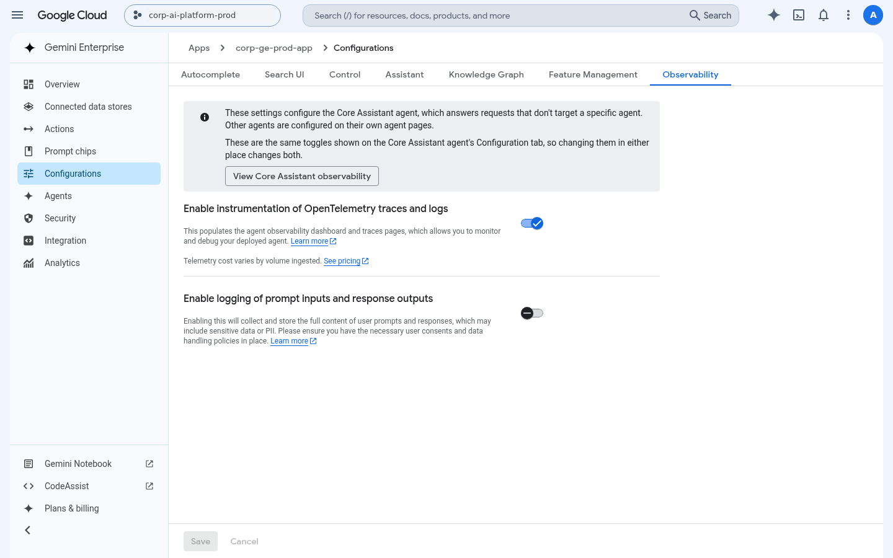

| UI 항목 | 기능 설명 | 기본값 (`Default`) | 실무 권장값 및 주의사항 (`Gotcha`) |
| :--- | :--- | :--- | :--- |
| **`Enable instrumentation of OpenTelemetry traces and logs`** | `Agent Observability Dashboard` 및 `Cloud Trace`에 지연 시간·도구 호출 트레이스 적재 | `Disabled` | 성능 진단·장애 추적(`Trace ID`)을 위해 **`Enabled` 권장** (수집량에 따라 `Cloud Telemetry` 과금 발생) |
| **`Enable logging of prompt inputs and response outputs`** | 사용자의 전체 `Prompt` 입력과 `Model` 응답 본문을 `Cloud Logging`에 저장 | `Disabled` | **주의**: 민감정보(`PII`)가 포함될 수 있으므로 사내 감사·동의 정책 수립 후 활성화. 개별 `Agent`는 각 `Agent` 페이지의 `Configuration` 탭에서 별도 설정 |

---

## B-12. `Agents` (내장 · 노코드 · 외부 `ADK`/`A2A` 에이전트 관리)

`Core Assistant`, `Google-made`(`Deep Research` 등), 임직원이 만든 `No-code Agent`/`Workflow`, 그리고 외부 등록 `ADK`/`A2A` `Agent` 전체를 관리하고 공유 승인 요청을 검토합니다.

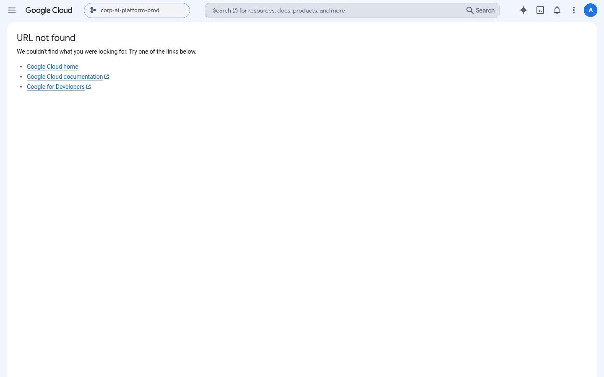

| UI 항목 | 기능 설명 | 실무 권장값 및 주의사항 (`Gotcha`) |
| :--- | :--- | :--- |
| **필터 `Tab` (`All` / `Google-made` / `Our agents`)** | 제공 주체별 `Agent` 분류 조회 | `Deep Research` 등 `Google-made` `Agent` 활성화 상태 확인 |
| **`Add agent`** | 신규 외부 `ADK` / `A2A` / `Dialogflow` `Agent` 등록 | 등록 1건당 `No-code Agents` 일일 생성 `Quota` 1단위 차감 |
| **`Configure agent logging`** | 지원되는 모든 `Agent`의 `Observability` 및 사용자 콘텐츠 로깅 기본값 일괄 이동 | 기본값은 모두 `Disabled`이므로 감사 요건에 맞춰 확인 |
| **`Procurement & integration requests` / `Review pending proposals`** | 임직원의 `Agent` 공유·연동 승인 대기 요청 검토 | `Feature Management`에서 관리자 승인 필수(`without admin approval = OFF`)로 운영할 때 이 화면에서 심사 |

---

## B-13. `Security` (`Insights` 보안 모니터링 & `Configuration` 보안 정책 통합)

`App` 단위의 보안 위반 탐지 대시보드(`Insights`)와 **`Agent Gateway`, `CMEK`, `Model Armor`, `Sensitive Data Protection (SDP)`** 4대 보안 설정(`Configuration`)을 한 곳에서 관리합니다.

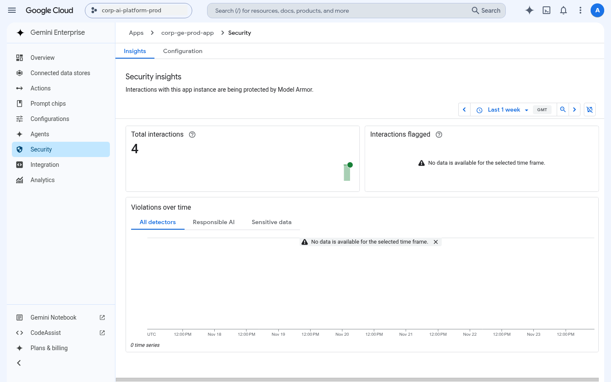

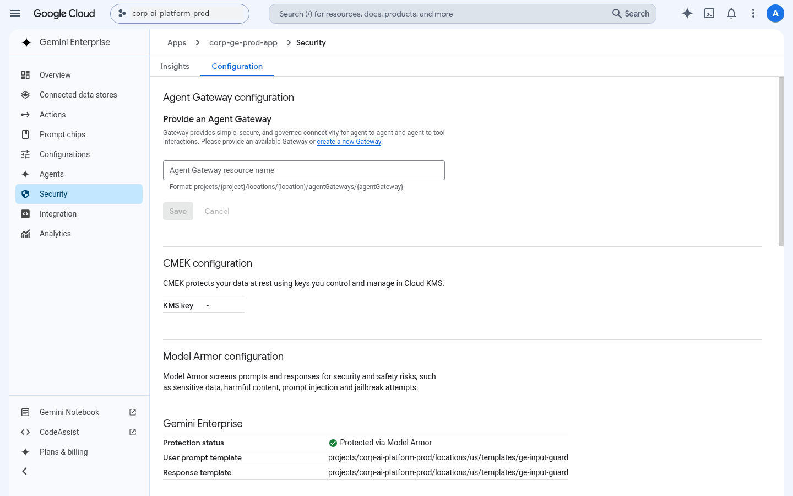

| 탭 / 섹션 | UI 항목 | 기능 설명 | 실무 권장값 및 주의사항 (`Gotcha`) |
| :--- | :--- | :--- | :--- |
| **`Insights`** | **`Total interactions` / `Interactions flagged` / `Violations over time`** | `Model Armor` 보호 상태, 총 상호작용 수, `Responsible AI` 및 `Sensitive data` 탐지 위반 추이 시각화 | 주간 보안 리뷰 시 오탐(`False Positive`) 및 차단 추이 점검 |
| **`Configuration`** | **`Agent Gateway configuration`** | `Agent-to-Agent` 및 `Agent-to-Tool`(`MCP`) 트래픽을 통제할 `Agent Gateway` 리소스(`projects/{project}/locations/{location}/agentGateways/{agentGateway}`) 연결 | Phase 2 외부 `MCP`/`ADK` 확장 시 보안 경계로 구성 |
| **`Configuration`** | **`CMEK configuration`** | 해당 `App`의 `Cloud KMS` 키 적용 현황 조회 | 실제 키 등록은 `Part A > Settings > CMEK`에서 수행 (`us`/`eu` 전용) |
| **`Configuration`** | **`Model Armor configuration` (`Gemini Enterprise` & `Gemini Notebook`)** | `User prompt template`, `Response template`, 장애 시 동작(`Allow user interactions`) 설정 | **중요 (`Scope` 차이)**: `Gemini Enterprise` `Model Armor`는 `App`별 독립 설정이지만, 하단 **`Gemini Notebook` `Model Armor`는 동일 `Project` 내 모든 `App`에 공통 적용**됨 |
| **`Configuration`** | **`Sensitive Data Protection configuration`** | ① `Connected data stores settings`, ② `Assistant setting`(대화 중 업로드 파일 검사), ③ `Gemini Notebook setting`(노트북 업로드 파일 검사)에 `SDP Content Policy` 연결 | **필수 선행 작업**: `gcp-sa-discoveryengine` 서비스 에이전트에 `roles/dlp.user` 권한 부여 후 동일 `Location`의 `SDP Policy` 바인딩. `Gemini Notebook` `SDP` 역시 `Project` 전체 공통 적용 |

---

## B-14. `Integration` (배포 채널) & `Analytics` (사용량 분석)

`Web App`, `API`, `Chrome`, `Slack` 등 최종 사용자 배포 채널을 구성(`Integration`)하고, `App` 단위 채택률·품질·가치 지표를 분석(`Analytics`)합니다.

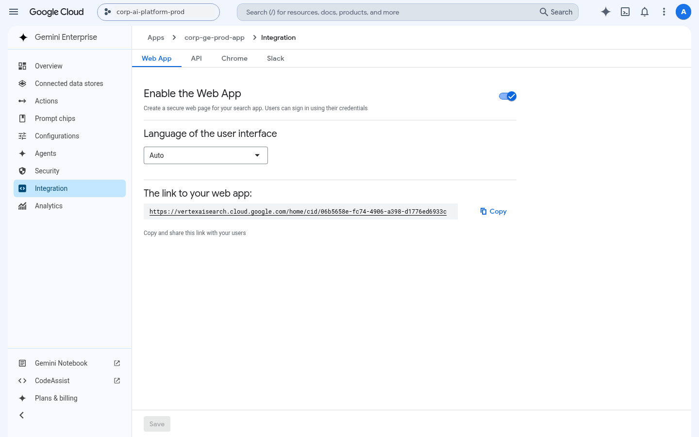

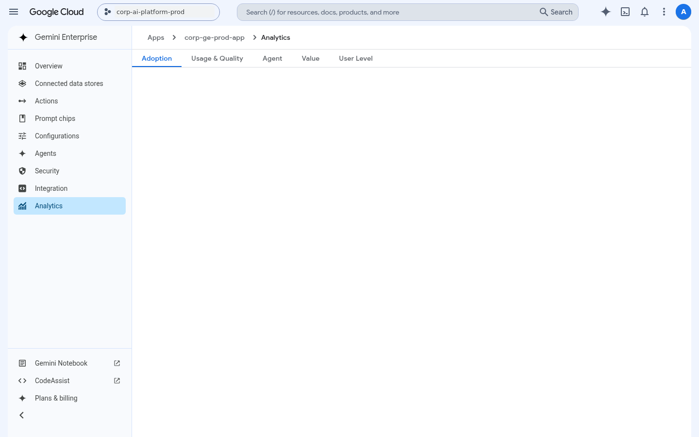

| 메뉴 | UI 항목 | 기능 설명 | 실무 권장값 및 주의사항 (`Gotcha`) |
| :--- | :--- | :--- | :--- |
| **`Integration`** | **`Web App` / `API` / `Chrome` / `Slack` `Tab`** | 배포 채널별 활성화 및 연동 설정 | `Web App` 탭에서 **`Enable the Web App`** 활성화, **`Language of the user interface`** (`Auto` 권장) 지정 및 최종 접속 `URL` 복사 |
| **`Analytics`** | **`Adoption` / `Usage & Quality` / `Agent` / `Value` / `User Level` `Tab`** | `App` 단위 활성 사용자 추이, 질문 품질, `Agent`별 사용량, 사용자 수준 채택률 리포트 | 부서별 정착률 리포팅 및 `Prompt Chips`·교육 개선 근거로 활용 |

---

## 공식 참조 문서 (`Official Public References`)

본 `Reference Guide`의 모든 설정 설명과 적용 범위(`Scope`) 기준은 아래 `Google Cloud` 공식 문서를 근거로 작성되었습니다.

1. **Google Cloud — Gemini Enterprise Overview & Architecture**: [Gemini Enterprise documentation](https://cloud.google.com/gemini/enterprise/docs/overview)
2. **Google Cloud — Access Control & Custom Roles**: [Access control with IAM](https://cloud.google.com/gemini/enterprise/docs/access-control) / [Create a custom role to restrict access to AI developer tools](https://cloud.google.com/gemini/enterprise/docs/ai-developer-tools-creating-custom-roles)
3. **Google Cloud — Licensing & UserStore Management**: [Get subscriptions and assign licenses](https://cloud.google.com/gemini/enterprise/docs/licenses)
4. **Google Cloud — Quotas & Pay-as-you-go**: [Quotas and pay-as-you-go usage](https://cloud.google.com/gemini/enterprise/docs/quotas-and-pay-as-you-go-usage)
5. **Google Cloud — Web App Feature Management & Canvas**: [Manage web app features](https://cloud.google.com/gemini/enterprise/docs/manage-web-app-features) / [Configure Canvas](https://cloud.google.com/gemini/enterprise/docs/configure-canvas)
6. **Google Cloud — AI Developer Tools (Antigravity) Settings**: [Configure AI developer tools settings](https://cloud.google.com/gemini/enterprise/docs/ai-developer-tools-settings)
7. **Google Cloud — Security (Model Armor, SDP, CMEK, Resource Access Control)**: [Configure Model Armor](https://cloud.google.com/gemini/enterprise/docs/configure-model-armor) / [Configure Sensitive Data Protection](https://cloud.google.com/gemini/enterprise/docs/configure-sdp) / [Customer-managed encryption keys (CMEK)](https://cloud.google.com/gemini/enterprise/docs/cmek)
8. **Google Cloud — Observability & Logging**: [Monitor and observe agents](https://cloud.google.com/gemini/enterprise/docs/observability) / [Track token usage for AI developer tools](https://cloud.google.com/gemini/enterprise/docs/ai-developer-tools-track-token-usage)
