# Gemini Enterprise & Google Antigravity Admin L100 · L200 실습 Portal

> <strong>Non-GWS 기업 맞춤 Step-by-Step 관리자 실습 Guide</strong>  
> **Google Workspace (GWS)** 를 사용하지 않고 **Gemini Enterprise Standard (500 Seats, NotebookLM 포함)** 와 **Google Antigravity** 두 가지 핵심 Solution만 도입한 환경에 맞추어, **① `Console` 어디를 클릭하는지** → **② 어떤 `CLI` · `REST API` · `SQL` · `JSON`을 복사해 실행하는지** → **③ 설정 뒤 무엇을 확인하는지** 순서대로 따라오실 수 있도록 구성했습니다.  
> 본 Guide의 `Google Cloud Console` · `Gemini Enterprise Web App` · `agy CLI` 화면은 실제 테스트 환경을 촬영한 뒤, `Project ID` · `Domain` · `Account` 식별자만 일반 예시(`corp-ai-platform-prod`, `example-corp.com`)로 치환하고 강조 번호를 표시한 화면입니다.

---

## 0. 전체 실습 구성 (5단계, 총 150분)

단일 **Google Cloud Project** 경계 위에서 일반 현업 임직원용 **GE Web App · NotebookLM**과 승인 개발자용 **Google Antigravity**를 자체 운영하는 데 필요한 핵심 설정과 자동화 절차를 5개 `Part`로 나누어 실습합니다.

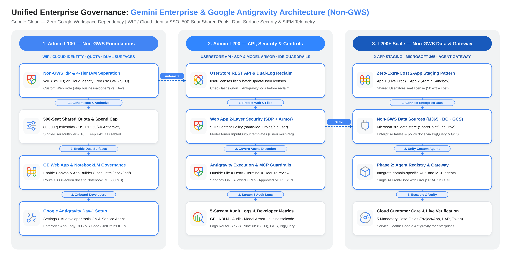

| 과정 구분 (시간) | 대상 환경 | 주요 실습 내용 |
| :--- | :---: | :--- |
| **Part 1 (30분)**<br/>`Admin L100 · M1` | `GCP Console` & `IAM` | • 배포 **`Location` 불변 원칙** 이해 및 추가 비용 `$0`의 **운영(`App 1`) · 검증(`App 2`) 2-App 분리**<br/>• **`Non-GWS` 표준 인증(`WIF` vs. `Cloud Identity Free`)** 및 일반 사용자 **`Antigravity` 차단 `Custom IAM Role`** |
| **Part 2 (40분)**<br/>`Admin L100 · M2` | `GE` & `Antigravity` | • 일 **`80,000 Query`**(`Web`) vs. 주 **`USD 1,250 Credit`**(`Antigravity`) 통제(`PAYG = Disabled`, `Multiplier = 10`)<br/>• `GWS` 없는 **`Canvas` 로컬 `Download`(`.html/.docx/.pdf/.pptx`)** 활성화 및 **`Antigravity` 초기 셋업** |
| **Part 3 (35분)**<br/>`Admin L200 · M3` | `UserStore API` & `Log Analytics` | • **`UserStore REST API`**(`userLicenses.list` · `batchUpdateUserLicenses`) `Seat` 수명주기 자동 연동<br/>• **`last_login_time`과 `Antigravity inference_response` `Log`** 를 함께 확인하는 30일 미사용 Seat 회수 |
| **Part 4 (30분)**<br/>`Admin L200 · M4` | `SDP` · `Armor` · `AG` | • `Web App` 2계층 방어: 첨부 반입 차단(**`SDP`**, `roles/dlp.user` 선행) + 입출력 분리 **`Model Armor`(`locations/us`)**<br/>• **`Antigravity` 로컬 실행 보안**: 작업 `Folder` 외부 `Deny`, `Terminal = Require review`, `Sandbox = ON`, `MCP Allowlist` |
| **Part 5 (15분)**<br/>`Admin L200+ · M5` | `Logging` & `Connectors` | • **5대 감사 · `Token` `Log Stream`** 외부 `SIEM`(`Pub/Sub` Pull) 연동 및 **`Microsoft 365 data store` (`GA`)** 확장<br/>• 운영 `Google Cloud Console` **10대 필수 점검 `Checklist`** 실시간 완료 체크 및 `Customer Care` 지원 체계 |

---

## 실습 전 준비: Admin 실습 File 7종 한 번에 Download (`GE_Antigravity_Admin_Lab_Files.zip`)

> `L100 · L200` 실습에서 사용하는 설정 Template 7종(`YAML` · `Option A/B 병렬 IAM Script` · `UserStore REST API` · `Log Analytics SQL` · `MCP JSON`)을 압축본 하나로 묶었습니다. 시작 전에 실습 `File` 묶음과 **18장 발표 자료(`GE_Antigravity_Admin_Slides.pdf`)** 를 먼저 내려받으세요.
>
> • <a href="./GE_Antigravity_Admin_Files.zip" download="GE_Antigravity_Admin_Lab_Files.zip"><strong>[Admin 실습 File 7종 전체 ZIP 한 번에 Download (GE_Antigravity_Admin_Lab_Files.zip)]</strong></a>  
> • <a href="./GE_Antigravity_Admin_Slides.pdf" download="GE_Antigravity_Admin_Slides.pdf" target="_blank"><strong>[18-Slide 발표 자료 PDF 바로 열기 (GE_Antigravity_Admin_Slides.pdf)]</strong></a>

<details class="file-list-details">
<summary><strong>개별 실습 File 7종 상세 역할 및 개별 Download 보기 (클릭하여 펼치기)</strong></summary>

| 번호 | File 명칭 (클릭 시 개별 Download) | 사용 Part | 핵심 용도 및 운영 활용처 |
| :---: | :--- | :---: | :--- |
| **01** | [`01_IAM_ge_standard_chat_no_antigravity_role.yaml`](./files/01_IAM_ge_standard_chat_no_antigravity_role.yaml) | **Part 1** | `Gemini Enterprise User` 역할의 권한 135개에서 `businessaicode.*` 5개와 `Project` 단위 역할에 넣을 수 없는 1개를 뺀 129개 권한의 `Custom IAM Role` 정의(일반 임직원의 `Antigravity` 사용 차단용) |
| **01b** | [`01b_IAM_parallel_wif_vs_cloud_identity_bindings.sh`](./files/01b_IAM_parallel_wif_vs_cloud_identity_bindings.sh) | **Part 1** | **`Option A (WIF principalSet://)` vs. `Option B (Cloud Identity Free group:)`** 두 방식의 직무별 `IAM` 권한 부여 명령어를 나란히 비교·실행하는 `Script` |
| **02** | [`02_UserStore_license_list_and_batch_update.sh`](./files/02_UserStore_license_list_and_batch_update.sh) | **Part 3** | 사내 계정 신청·퇴사 연동 Batch `Server`에서 전체 `Seat` 현황(`lastLoginTime`) 조회 및 일괄 `Seat` 할당·회수를 수행하는 `UserStore REST API` Template |
| **03** | [`03_Observability_Analytics_seat_activity_30d.sql`](./files/03_Observability_Analytics_seat_activity_30d.sql) | **Part 3** | Seat 회수 전에 `Antigravity inference_response` `Log`에서 사용자별 최근 30일 호출을 집계하는 `SQL` |
| **04** | [`04_Security_sdp_and_model_armor_setup.sh`](./files/04_Security_sdp_and_model_armor_setup.sh) | **Part 4** | `SDP` 정책 연결 전에 필요한 `roles/dlp.user` 부여와 `locations/us` 입력용 `Model Armor Template` 생성 `Script` |
| **05** | [`05_Antigravity_mcp_allowlist_sample.json`](./files/05_Antigravity_mcp_allowlist_sample.json) | **Part 4** | `Settings > AI developer tools`의 `Allowed server configuration`에 붙여넣는 사내 승인 `local_servers` · `remote_servers` `JSON` 예시 |
| **06** | [`06_Logging_unified_5stream_sink.sh`](./files/06_Logging_unified_5stream_sink.sh) | **Part 5** | 5개 `Log Stream`을 외부 `SIEM`이 읽는 `Pub/Sub` Topic으로 보내는 `Log Sink` 생성 `Script`(사내 인바운드 방화벽 변경 없음) |

</details>

---

# [Part 1 · Admin L100] 기반 구조 · Non-GWS 인증(IdP) · 4계층 IAM 설계

### Step 1-1. 배포 `Location` 불변 원칙 확인 및 무과금 `2-App` 분리(`Prod` + `Sandbox`) 구성하기

> **핵심 포인트:**  
> 1. `App` 생성 시 선택한 **`Location` (`global` 또는 `us` / `eu` Multi-Region)** 은 생성 이후 다른 지역으로 변경하거나 데이터를 자동 이전할 수 없습니다 (`global`: 최신 `Model`과 기능이 먼저 제공됨 / `us·eu`: `Access Transparency`처럼 Multi-Region이 필요한 통제를 쓸 때 선택).  
> 2. `Gemini Enterprise` `Seat`는 개별 `App`이 아니라 해당 `Project · Location`의 **`UserStore` 사용자(`userPrincipal`) 단위**로 할당됩니다. 따라서 운영용 **`App 1 (Prod)`** 외에 관리자·운영 `Partner` 전용 검증용 **`App 2 (Sandbox)`** 를 추가 생성해도 **추가 `License` 비용은 `$0`** 입니다.

1. `Google Cloud Console` → 좌측 메뉴 **`Gemini Enterprise` > `Apps`** 진입 후 상단 **`Region`** 선택기가 **`global`**(또는 운영 대상 `Location`)로 맞춰져 있는지 확인합니다.
2. **`+ CREATE APP`** 클릭 시 표시되는 `Location` 불변 안내를 확인하고 현업 임직원 전체용 **`App 1 (Prod)`** 과 관리자 사전 검증용 **`App 2 (Sandbox)`** 를 분리 구성합니다.
3. `App` 단위로 분리되는 항목(`Data Store` 연결, `Feature Management`, `Assistant`용 `Model Armor` · `SDP`)은 **`App 2 (Sandbox)`에서 먼저 검증한 뒤 `App 1`에 반영**합니다. 반면 `Settings > Authentication`, `AI developer tools`, `Gemini Notebook` 보안 설정은 `Project` 전체에 바로 적용되며, 일반 사용자의 `App 2` 접근까지 권한으로 막으려면 `Resource access control` 또는 `App` 단위 `IAM`을 함께 설정합니다.

**화면 확인 포인트:** (`① 상단 Region: global 불변 경계 확인` → `② 동일 Project 내 $0 무과금 Sandbox App 2 병렬 구성`)
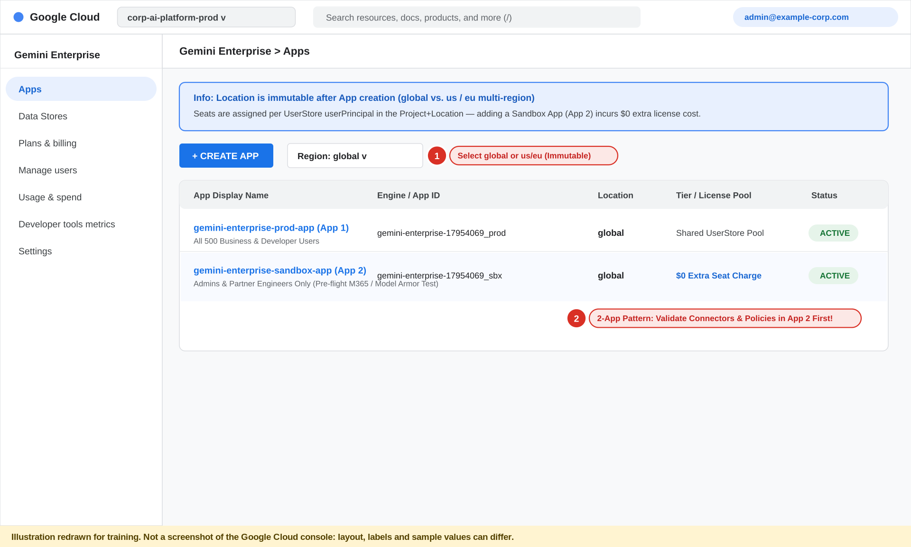

---

### Step 1-2. `Non-GWS` 기업 표준 인증(`Option A: WIF` vs. `Option B: Cloud Identity Free`) 병렬 비교 학습 및 `userPrincipal` 연속성 확립

> **핵심 의사결정 및 불변 원칙:**  
> • 유료 `Google Workspace`를 쓰지 않는 기업은 아래 **`Option A (WIF / 3rd Party Identity)`** 와 **`Option B (Cloud Identity Free / 무료 Google Identity)`** 중 하나를 `Location`별로 선택합니다.  
> • **Google 공식 문서 기준**: **`Microsoft 365` (`SharePoint` · `OneDrive` · `Outlook`)를 색인형(`Data Ingestion`)으로 연결해야 하는 경우에는 `Option A (Entra ID + WIF + SCIM)`가 필수**이며, 그 외 신규 구축 환경에서는 관리 단순성과 전 `IDE` 호환성이 뛰어난 **`Option B (Google Identity / Cloud Identity Free)`가 기본 권장**됩니다.  
> • **사후 변경 절대 금지**: 오픈 이후 두 방식 간 전환하거나 `userPrincipal` / `google.subject` 식별자 `Format`을 바꾸면 **기존 대화 이력 · `Saved Memory` · `Canvas` · `Notebook`이 새 계정으로 이관되지 않으며 기존 색인형 `Data Store`도 삭제 후 다시 만들어야** 합니다.

| 의사결정 비교 축 | Option A: `Workforce Identity Federation (WIF / BYOID)` | Option B: `Cloud Identity Free` (`무료 Google Identity`) |
| :--- | :--- | :--- |
| **권장 선택 시나리오** | • **`Microsoft 365` (`SharePoint`·`OneDrive`·`Outlook`) 색인형(`Ingestion`) 연동 예정 기업 필수**<br/>• 별도 Google 계정 `Directory` 생성 자체를 원치 않는 조직 | • **Google 공식 신규 구축 기본 권장 방식** (`M365 Ingestion` 미사용 또는 `Federation`만 사용 시)<br/>• 표준 `Google Groups` 기반 직관적 권한 관리 선호 조직 |
| **비용 및 계정 구조** | • 추가 인증 비용 `$0` (`Organization` 하위 `global` `Workforce Pool`에 외부 `IdP` 직접 연합) | • **추가 License 비용 `$0`** (`Gmail`·`Drive` 유료 `GWS` 없이 관리형 Google 계정·`Group`만 무료 생성) |
| **임직원 비밀번호 경험** | • 기존 사내 `SSO`(`Entra ID` · `Okta` · 사내 `SAML/OIDC`) 비밀번호 그대로 사용 | • `admin.google.com`에서 `3P SAML/OIDC SSO` 연동 시 **동일하게 기존 사내 `SSO` 비밀번호 그대로 사용** |
| **`IAM` 권한 부여 문법** | • `principalSet://iam.googleapis.com/locations/global/workforcePools/POOL_ID/group/GROUP_ID` | • 직관적인 표준 Email 문법: **`group:ge-business-users@example-corp.com`** |
| **`Antigravity` 및 `IDE` 지원** | • `Use Business Account` → 하단 **`Use Advanced SSO Config`** 클릭 후 `Pool/Provider` 경로 입력<br/>• **주의: `Android Studio` Plugin은 3P `IdP` 미지원** | • `Use Business Account` → 파란색 **`Continue with Google Cloud` 원클릭 진입**<br/>• **`Android Studio` 포함 전 `IDE` 전체 지원** |
| **핵심 운영 주의사항** | • `Pool`은 반드시 `--location=global` 생성<br/>• `google.subject`는 반드시 **소문자 `Email` 매핑**(`GUID`로는 매핑하지 않음)<br/>• `Entra ID` `150(SAML)/200(OIDC)`개 `Group` 초과 시 누락 방지 Filter 필수 | • `Super Admin` 계정은 항상 `SSO`를 거치지 않으므로 Google 비밀번호와 2단계 인증으로 따로 보호<br/>• 복수 Email Domain 사용 시 `Email Alias` 등록<br/>• 임직원 PC에서 개인 `@gmail.com`과 **업무용 `Chrome/Edge Profile` 분리** 안내 |


#### [Option A 상세 구성 Guide] `Workforce Identity Federation (WIF / 3rd Party Identity)` 5단계

1. **`Step A-1`: 조직(`Organization`) 수준 `global` `Workforce Pool` 생성**
   - `GCP Console` → `IAM & Admin > Workforce Identity Pools` 진입 후 반드시 **`--location=global`** 에 `Pool`을 생성합니다(`GE App`이 `us/eu`이더라도 `Pool` 위치에 `us/eu`를 넣으면 `INVALID_ARGUMENT` 오류가 발생합니다).
2. **`Step A-2`: `Attribute Mapping` 소문자 `Email` 고정 (`GUID` 절대 금지)**
   - `OIDC` 또는 `SAML 2.0` `Provider` 등록 시 `google.subject`에 반드시 **소문자 `Email`** 을 매핑하고 `Entra ID`에서 사용자당 소속 `Group`이 `150개(SAML)` / `200개(OIDC)`를 넘지 않도록 `Groups assigned to the application` Filter를 설정합니다:

```text
google.subject=assertion.email.lowerAscii()
google.groups=assertion.groups
google.display_name=assertion.given_name
```

3. **`Step A-3`: `SCIM` Directory 동기화 구성 (`Entra ID` / `Okta`)**
   - 대량 `Group` 권한 색인 및 사용자가 `Notebook` · `Custom Agent`를 동료에게 공유할 때 이름/Email 자동완성(`Autocomplete`)이 동작하도록 `SCIM` Provisioning을 연결합니다.
4. **`Step A-4`: `Gemini Enterprise > Settings > Authentication` 바인딩**
   - 대상 `Location`(`global`)의 **`Add identity provider`** 클릭 → **`3rd party identity`** 선택 → 생성한 `global` `Workforce Pool` 지정 후 **`Save changes`** 를 클릭합니다.
5. **`Step A-5`: `principalSet://` 직무별 `IAM` 부여 및 `Antigravity` 고급 `SSO` 안내**
   - 실습 `File` `01b`처럼 `principalSet://` 경로로 현업 `Group`과 개발자 `Group` 권한을 분리하고 개발자에게는 `Antigravity` 초기 화면에서 `Use Business Account` → **`Use Advanced SSO Config`** 에 `Pool/Provider` 경로를 입력하도록 안내합니다:

```bash
gcloud projects add-iam-policy-binding PROJECT_ID \
  --member="principalSet://iam.googleapis.com/locations/global/workforcePools/corp-sso-pool/group/ENTRA_BIZ_GROUP_ID" \
  --role="projects/PROJECT_ID/roles/geStandardChatUser"
```

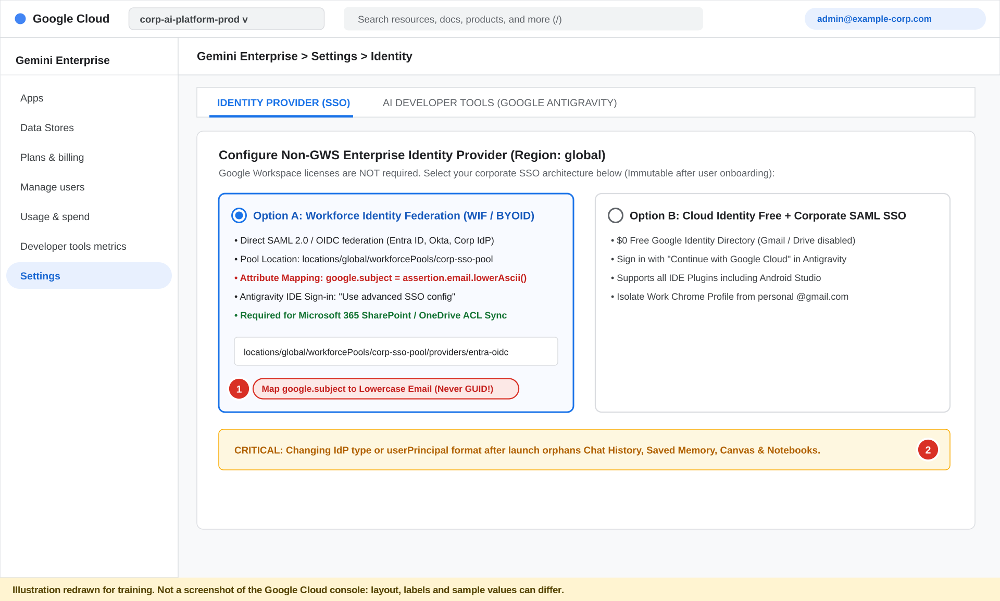


#### [Option B 상세 구성 Guide] `Cloud Identity Free` (`무료 Google Identity`) 5단계

1. **`Step B-1`: 무료 `Cloud Identity Free` (`$0`) 활성화 및 사내 `Domain` 인증**
   - `Google Admin Console`(`admin.google.com`)에서 무료 **`Cloud Identity Free`** 계정을 만들고 사내 `DNS TXT` Record로 회사 `Domain` 소유권을 인증합니다.
   - 무료 Edition의 기본 사용자 수는 50명입니다. 그보다 많이 등록하려면 사용자 수 상향을 먼저 요청합니다.
2. **`Step B-2`: 사용자 계정 및 직무별 `Google Groups` 동기화 (`CSV` / `Entra` / `GCDS`)**
   - **초기/소규모**: `admin.google.com > Directory > Users`에서 `Bulk upload users (CSV)`로 사내 Email 계정을 일괄 생성합니다.
   - **전사 자동화(권장)**: 사내 `Microsoft Entra ID`(`Google Cloud / G Suite Connector` Provisioning App), `Okta`, 또는 `Active Directory`(`GCDS`)와 자동 동기화를 연결하고 권한 분리용 2개 `Google Group`(**`ge-business-users@example-corp.com`**, **`ge-antigravity-devs@example-corp.com`**)을 생성합니다(다중 Email 보유 임직원은 `Email Alias` 추가).
3. **`Step B-3`: 사내 `IdP`와 `3P SAML 2.0 / OIDC SSO` 연동 (별도 비밀번호 제거)**
   - `admin.google.com > Security > Authentication > SSO with third party IdP`에서 사내 `Entra ID` · `Okta` · 통합 `SSO` Sign-in `URL`과 인증서를 등록합니다.
   - 이제 임직원은 Google 비밀번호를 따로 만들 필요 없이 **기존 사내 `SSO` 창으로 동일하게 인증**됩니다. `Super Admin` 계정은 항상 `SSO`를 거치지 않고 Google 비밀번호로 Sign-in하므로 2단계 인증을 적용해 따로 보호합니다.
4. **`Step B-4`: `Gemini Enterprise > Settings > Authentication`에서 `Google Identity` 선택**
   - `GCP Console > Gemini Enterprise > Settings > Authentication`에서 대상 `Location`(`global`)의 **`Add identity provider`** 클릭 → 기본 권장 항목인 **`Google Identity`** 를 선택하고 **`Save changes`** 를 클릭합니다.
5. **`Step B-5`: 직관적 `group:` Email `IAM` 부여 및 `Antigravity` 원클릭 `Sign-in` 안내**
   - 복잡한 `principalSet://` 경로 없이 아래처럼 직관적인 `group:` Email로 현업 사용자(`Antigravity` 차단)와 승인 개발자 권한을 즉시 분리합니다(`01b` `Script` 수록):

```bash
# 일반 현업 임직원 Group (GE Web App + Canvas 허용 / Antigravity 차단)
gcloud projects add-iam-policy-binding PROJECT_ID \
  --member="group:ge-business-users@example-corp.com" \
  --role="projects/PROJECT_ID/roles/geStandardChatUser"

# 승인 개발자 Group (GE Web App + Google Antigravity 전체 허용)
gcloud projects add-iam-policy-binding PROJECT_ID \
  --member="group:ge-antigravity-devs@example-corp.com" \
  --role="roles/discoveryengine.agentspaceUser"
```

   - **임직원·개발자 접속 안내**: `Antigravity` 및 모든 `IDE`(`Android Studio` 포함)에서 `Use Business Account` → 파란색 **`Continue with Google Cloud` 버튼 원클릭**으로 즉시 진입하며 개인 `@gmail.com` Cookie와 섞이지 않도록 **업무 전용 `Chrome / Edge Profile` 생성**을 함께 안내합니다.

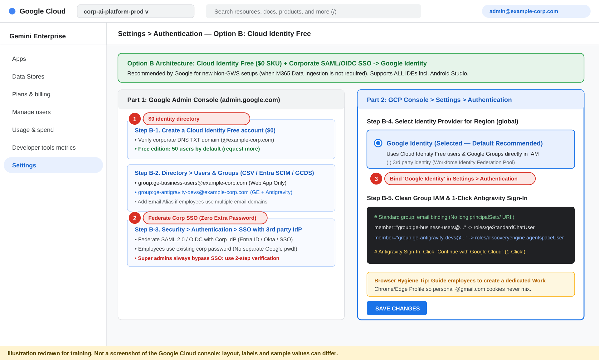

---

### Step 1-3. 직무별 4계층 `IAM Role` 분리: 일반 임직원용 `Antigravity` 차단 `Custom Role` 생성하기

> **핵심 포인트:**  
> 전사 임직원은 `GE Web App`을 쓰고 **승인된 개발자 `Group`만 `Google Antigravity`를 사용**하도록 통제하려면, 일반 임직원 `Group`에는 표준 `Gemini Enterprise User` 역할에서 **`businessaicode.`로 시작하는 권한(현재 5개)만 뺀 `Custom IAM Role`** 을 부여합니다. `Canvas`에 필요한 **`discoveryengine.immersiveArtifacts.*` 7개 권한**은 Preview 권한이라 `Console`에서는 추가할 수 없습니다. 아래처럼 `gcloud`로 역할을 만들고 7개가 들어갔는지 확인합니다.

1. 실습 `File` `01_IAM_ge_standard_chat_no_antigravity_role.yaml`을 준비하고 아래 `gcloud` 명령을 복사해 대상 `Project`에 `Custom Role`(`geStandardChatUser`)을 생성합니다:

```bash
gcloud iam roles create geStandardChatUser \
  --project=PROJECT_ID \
  --file=./files/01_IAM_ge_standard_chat_no_antigravity_role.yaml

# Canvas 권한 7개가 포함됐는지 확인 (결과: 7)
gcloud iam roles describe geStandardChatUser --project=PROJECT_ID \
  --format="value(includedPermissions)" | tr ';' '\n' | grep -c immersiveArtifacts
```

   표준 역할의 권한 목록은 제품 Update에 따라 바뀝니다. 운영에 적용하기 전에 `gcloud iam roles describe roles/discoveryengine.agentspaceUser` 결과와 실습 `File`의 목록을 비교합니다.

2. 생성 후 **`IAM & Admin` > `IAM`** 메뉴에서 아래 4계층 기준에 따라 `Group`별 권한을 분리 부여합니다:
   - **일반 현업 임직원 `Group` (`Web App` 전용)**: 방금 만든 **`GE Standard Chat User (No Antigravity)`** (`projects/PROJECT_ID/roles/geStandardChatUser`)
   - **승인된 개발자 `Group` (`GE` + `Antigravity` 허용)**: 표준 **`Gemini Enterprise User`** (`roles/discoveryengine.agentspaceUser`)
   - **고객사 · 운영 `Partner` `Admin`**: `roles/discoveryengine.agentspaceAdmin` + `roles/serviceusage.serviceUsageConsumer` (**주의: 관리자가 직접 `Antigravity`를 실행·테스트하려면 `agentspaceUser` 역할도 함께(`AND` 조건) 부여해야 합니다.**)
   - **계정(`Seat`) 연동 · `SIEM` 수집용 전용 `Service Account` (자동화 연동 시 용도별 분리 생성, 초기 수동 운영 시 생략 가능)**:
     - `Seat` 프로비저닝 Batch `SA`: `discoveryengine.userStores.listUserLicenses`, `discoveryengine.userStores.batchUpdateUserLicenses`, `serviceusage.services.use` 3개 권한 `Custom Role` 권장 (간편 구성 시 `roles/discoveryengine.agentspaceAdmin` / 주의: `viewer` 역할에는 `listUserLicenses` 권한 없음)
     - 외부 `SIEM` 수집기 `SA`: `Pub/Sub` 구독 시 `roles/pubsub.subscriber`, `Logging API` 직접 조회 시 `roles/logging.viewer` · `privateLogViewer` (`Log Router Sink` 자체는 Google 관리형 `Writer Identity`가 수행)

**화면 확인 포인트:** (`① Canvas용 immersiveArtifacts.* 권한 유지` → `② businessaicode.* 5종 제거로 일반 임직원의 Antigravity 사용 차단` → `③ Admin+User AND 조건 확인`)
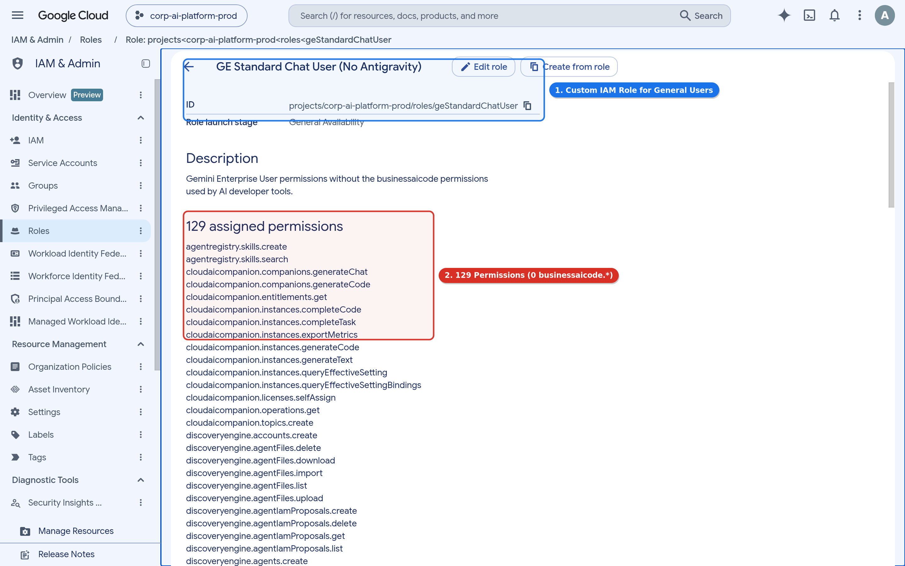

---

### [Part 1 추가 확인 과제 · 선택] 관리자 계정으로 `Antigravity`를 쓸 수 없는 원인과 `2-App` 권한 격리 점검

1. **확인 1 (`Admin` 단독 역할 검증)**: `roles/discoveryengine.agentspaceAdmin`만 가진 테스트 관리자 계정으로 `Antigravity` 진입 시 왜 사용 권한 오류가 발생하는지 확인하고 `roles/discoveryengine.agentspaceUser` 병행 부여 후 정상 진입을 확인해 보세요.
2. **확인 2 (`App 2 Sandbox` 노출 격리)**: 검증용 `App 2`의 `Web App URL`을 일반 현업 부서에 공지하지 않고 관리자 전용 테스트 채널로만 분리 운영하는 내부 변경관리 절차를 수립해 보세요.

---

# [Part 2 · Admin L100] Standard 500 Seats Quota · Web App 로컬 반출 · Antigravity 초기 셋업

### Step 2-1. `Standard` 500 Seats 공유 `Quota` · 주간 `Antigravity Credit` 확인 및 초과 과금 방지 설정하기

> **핵심 포인트:**  
> • **`GE Web App` (`1P Gemini` 전 계열)**: `Seat`당 일 160회 × 500 Seats = **일 `80,000 Queries` 공유 `Pool`**. 구독 `Quota`는 Query 횟수로 계산하며 공식 `Quota` 표에는 Google `Model`별 차등이 없습니다.  
> • **`Google Antigravity` (`Desktop` · `agy CLI` · `IDE Extension` 합산)**: `Seat`당 월 `USD 10`(= 주 `USD 2.50`) × 500 Seats = **주당 `USD 1,250 Credit` 공유 `Pool`** (7일 주기 초기화). 횟수가 아닌 **달러 금액(`USD`) 기준 차감**이므로 대형 `Model`·장문 `Code Context` 호출 시 소진 속도가 빨라집니다.

1. 좌측 메뉴 **`Gemini Enterprise` > `Usage & spend`** 로 이동합니다.
2. 타사 유료 `3P Model`(`Anthropic Claude Opus / Sonnet 5.5`: 기본 `Pool` 미포함, 첫 호출부터 `Token` 종량 과금)이나 한도 초과 호출로 예기치 않은 요금이 청구되지 않도록 **`Pay-as-you-go usage above quota = Disabled`** (기본값) 상태를 확인합니다.
3. 특정 헤비 유저 1인이 전사 주간 `Antigravity Credit`(`USD 1,250`)을 독점 소진하지 못하도록 **`Limit any single-user's quota (Multiplier)` 값을 `10`** (1인당 주간 최대 `USD 25` 상한; 집중 통제 시 `5`)으로 입력하고 **`SAVE`** 를 클릭합니다.

**화면 확인 포인트:** (`① Pay-as-you-go = Disabled 유지로 초과 과금 $0 보장` → `② Multiplier = 10 설정으로 개발자 1인당 주간 최대 $25 상한 적용`)
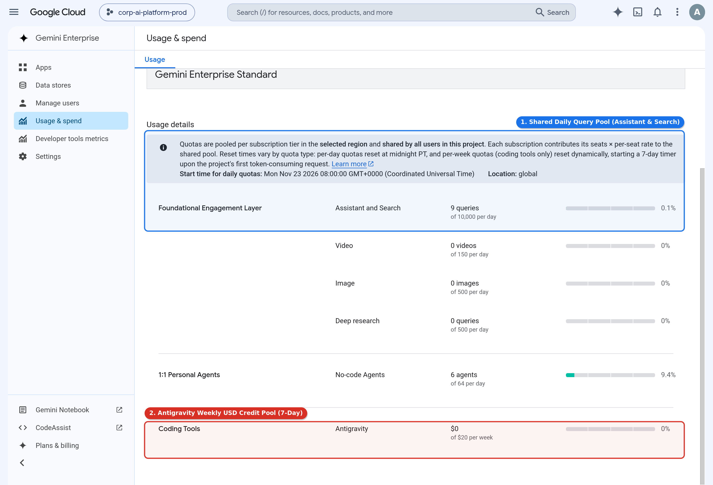

---

### Step 2-2. `Non-GWS` `Web App` 핵심 설정: `Canvas` 로컬 `Download` 켜기 · `Drive Picker` 끄기 · 대용량 분기

> **핵심 포인트:**  
> `Canvas`는 기본으로 꺼져 있습니다. `Google Workspace`를 쓰지 않는 환경에서는 **`Enable canvas`와 `Enable app builder`를 켜야** 임직원이 결과물을 PC로 내려받을 수 있습니다. 문서는 `.docx`·`.pdf`, 발표 자료는 PowerPoint·`.pdf`, Web App은 `.html`로 받습니다.

1. **`Apps` > 운영 `App` 클릭 > 좌측 `Configurations` > 상단 `FEATURE MANAGEMENT` `Tab`** 으로 이동합니다.
2. 아래 3가지 Switch를 순서대로 조정한 뒤 하단 **`SAVE`** 버튼을 클릭합니다:
   - **`① Enable canvas = ON`** 및 하위 **`Enable app builder = ON`** 전환
   - **`② Enable Google Drive upload = OFF`** 확인 (`Google Drive`를 쓰지 않는 환경에서는 켜지 않습니다)
   - **`③ Gemini model availability`**: `Model selector = ON` 활성화 후 `App 2 (Sandbox)`에서 검증을 마친 `1P Gemini 4` 계열 선택 (`Enable third-party models`는 `OFF` 유지)
3. **현업 대용량 문서 문의 대응 기준**: 일반 `Assistant Chat`은 단일 `Session` 누적 **`800,000 Tokens`** 및 확장자별 크기 상한(`.json` 1 MB, `.md/.py` 2 MB, `.docx/.html` 3 MB, `.txt/.csv` 7 MB, `.xlsx` 압축 해제 50 MB / 1,500만 `Cells`, `.pdf/.pptx` 100 MB)이 적용되므로, **5 MB 이상의 규정집·심의 기준서는 문서당 `500 MB` 로컬 업로드를 지원하는 `Gemini Notebook Enterprise` 또는 `Projects > Knowledge`에 올리도록 안내**합니다. 민감정보가 든 문서를 `NotebookLM`에 올리게 하려면 Step 4-1의 `NotebookLM` 확인 사항을 먼저 점검합니다.

**화면 확인 포인트 1 (`Admin Console`):** (`① Enable canvas & App builder ON` → `② Google Drive upload OFF 확인` → `③ 1P Gemini Model 노출 제어`)
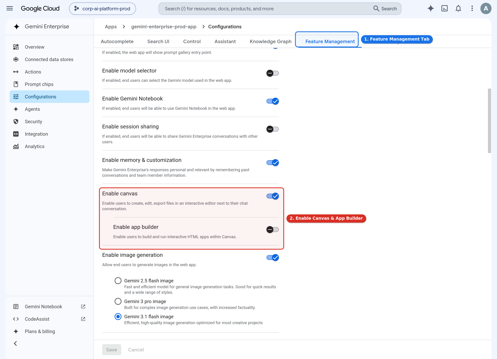

**화면 확인 포인트 2 (`사용자 Web App`):** (`Canvas` 활성화 즉시 우측 편집창에서 발표 자료·문서를 생성하고 `.pptx` / `.pdf` / `.docx` 로컬 `File`로 바로 `Download`)
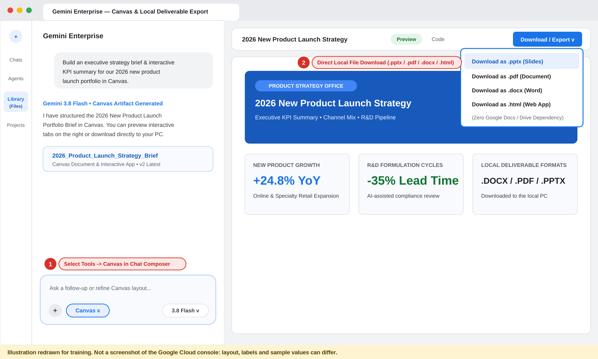

---

### Step 2-3. `Google Antigravity` (`AI developer tools`) 초기 활성화 · `Service Agent` 복구 · 기업용 `Client` 표준 `Sign-in`

> **핵심 포인트:**  
> 1. `Antigravity`를 켜려면 해당 `GCP Project`가 **유료로 전환한 Self-serve(Online) 과금 계정, Invoiced 과금 계정, Invoiced 계정의 Subaccount 중 하나**에 연결되어 있고 **`discoveryengine.googleapis.com` 및 `businessaicode.googleapis.com`** 두 `API`가 활성화되어 있어야 합니다.  
> 2. 기업용으로 지원되는 `Client`는 **`Antigravity` App, `agy CLI`, `IDE Extension`(`VS Code` · `Visual Studio` · `JetBrains` · `Zed` · `Xcode`), `Android Studio`** 입니다. 관리자가 켠 기능을 쓰려면 App `v2.18.0` 이상 또는 `agy CLI v1.2.10` 이상이 필요합니다. `/swarm` 명령은 App `v2.32.0` 이상 또는 `agy CLI v1.5.7` 이상에서 동작합니다.

1. **`Settings` > `AI DEVELOPER TOOLS` `Tab`** 에서 상단 활성화 `Switch`를 **`ON`** 으로 켭니다. 요청이 **`Service agent ... not found`** 오류로 실패하면 `Switch`를 껐다 켜거나 아래 명령으로 `Service Agent`를 다시 만듭니다:

```bash
gcloud beta services identity create --service=businessaicode.googleapis.com --project=PROJECT_ID

gcloud projects add-iam-policy-binding PROJECT_ID \
  --member="serviceAccount:service-PROJECT_NUMBER@gcp-sa-businessaicode.iam.gserviceaccount.com" \
  --role="roles/businessaicode.serviceAgent"
```

2. 개발자에게 Sign-in 방법을 안내합니다.
   - **`Antigravity` App**: 첫 화면에서 **`Use Business Account`** 를 누른 뒤 **`Continue with Google Cloud`** 로 Sign-in합니다.
   - **`agy CLI`**: **`Use a Google Cloud project`** 를 고른 다음 `Cloud Identity Free` 환경은 **`Continue with Google Cloud`**, 사내 `IdP`를 `WIF`로 연결한 환경은 **`Use advanced SSO config`** 를 선택합니다.
   - 두 경우 모두 `Seat`가 할당된 `Project`를 지정합니다.

**화면 확인 포인트 1 (`agy CLI` Sign-in 방식 선택):** 개인 계정용 `Google OAuth`가 아니라 **`Use a Google Cloud project`** 를 선택합니다.
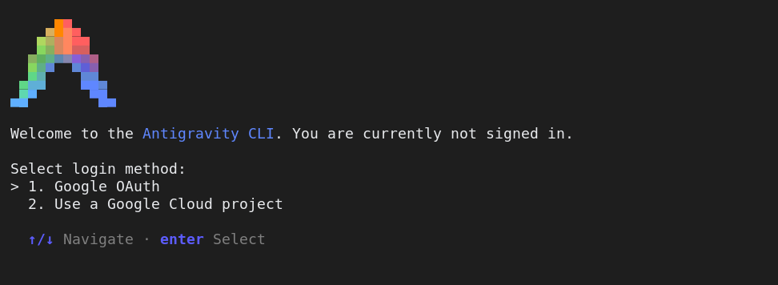

**화면 확인 포인트 2 (`Google Cloud` Sign-in 방식):** `Cloud Identity Free`는 **`Continue with Google Cloud`**, `WIF`는 **`Use advanced SSO config`** 를 선택합니다.
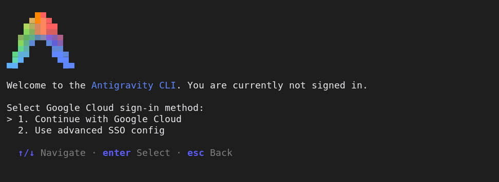

---

### [Part 2 추가 확인 과제 · 선택] 개발자 로컬 `GOOGLE_CLOUD_PROJECT` 환경변수 충돌 점검

* 개발자 PC의 `.zshrc` 또는 `.bashrc`에 과거 테스트용 타 `GCP Project`의 `export GOOGLE_CLOUD_PROJECT=...` 환경변수가 남아 있으면 `Antigravity` 또는 `agy CLI`가 엉뚱한 `Project`로 호출을 보내 `License`를 찾지 못하는 오류가 발생할 수 있습니다. 개발자 배포 공지문에 `env | grep GOOGLE_CLOUD` 사전 정리 항목을 추가해 보세요.

---

# [Part 3 · Admin L200] UserStore REST API Seat 수명주기 자동화 & 통합 Seat 회수

### Step 3-1. `Manage users` 정원 보호(`Auto-assign OFF`), `CSV` 추출 및 대기 수요 파악하기

> **핵심 포인트:**  
> 500 Seats 정원이 거의 찬 시점에는 미할당 임직원이 우연히 링크를 클릭해 잔여 `Seat`를 선점하지 못하도록 **`Assign licenses automatically`를 `OFF`로 전환**하고, `Export all users (CSV)`로 `Seat` 할당 후 14일 이상 한 번도 접속하지 않은 계정을 즉시 식별합니다.

1. 좌측 메뉴 **`Gemini Enterprise` > `Manage users`** 로 이동합니다.
2. 상단 **`Assign licenses automatically`** Checkbox를 해제(`OFF`)하여 승인된 대상자에게만 `Seat`가 할당되도록 보호합니다.
3. **`Export all users`** 를 클릭해 전체 명단을 CSV로 내려받습니다:
   - `ASSIGNED` 상태이면서 **`last_login_time` 열이 비어 있는 계정** → `Seat` 할당 후 한 번도 Sign-in하지 않은 1차 독려/회수 대상
   - CSV의 상태 값은 `ASSIGNED` · `NO_LICENSE` · `BLOCKED` 세 가지입니다. `Seat` 없이 접속을 시도한 사용자는 `REST API`의 `licenseAssignmentState = NO_LICENSE_ATTEMPTED_LOGIN` Filter로 조회합니다(Step 3-2).

**화면 확인 포인트:** (`① 정원 근접 시 Auto-Assign OFF` → `② Export all users로 CSV 추출` → `③ last_login_time이 빈 계정 확인`)
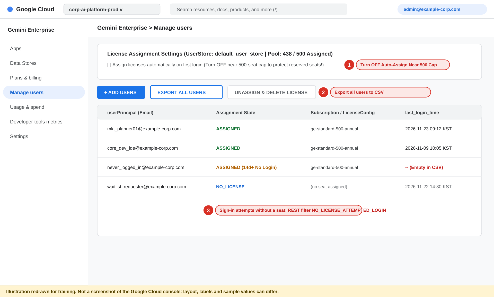

---

### Step 3-2. `Discovery Engine UserStore REST API` 기반 `Seat` 수명주기(할당·회수) 자동화 연동하기

> **핵심 포인트:**  
> `Google Workspace`를 쓰지 않으므로 사내 계정 신청·퇴사 변동에 따른 `Seat` 자동화 `API`도 **`Discovery Engine UserStore REST API`** 하나로 일원화됩니다. `batchUpdateUserLicenses` 호출 한 번으로 **신규 승인 대상자 `Seat` 할당(`licenseConfig` 명시)** 와 **퇴사·휴면자 `Seat` 회수(`licenseConfig` 생략 + `deleteUnassignedUserLicenses: true`)** 를 동시에 처리합니다.

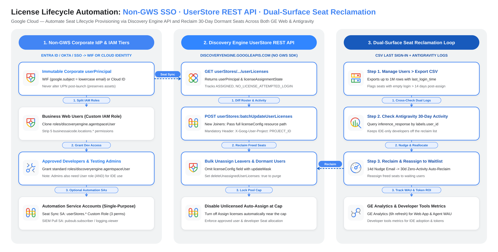

1. 사람 관리자(`OAuth` 만료 · 과도한 삭제 권한)와 분리된 `Seat` 연동 전용 `Service Account`를 만들고 최소 권한(`discoveryengine.userStores.listUserLicenses`, `discoveryengine.userStores.batchUpdateUserLicenses`, `serviceusage.services.use` 3개 권한 `Custom Role`, 또는 간편 구성 시 `roles/discoveryengine.agentspaceAdmin`)을 부여한 뒤 모든 요청에 `X-Goog-User-Project: PROJECT_ID` `Header`를 포함합니다(`viewer` 역할에는 `listUserLicenses` 권한이 없습니다).
2. 실습 `File` `02_UserStore_license_list_and_batch_update.sh`의 조회 및 일괄 변경 `REST API` 명령을 복사해 실행 구조를 확인합니다:

```bash
# 1) 전체 사용자 Seat 할당 상태 및 마지막 Sign-in 시각(lastLoginTime) 조회 (userLicenses.list)
#    `Seat` 없이 접속을 시도한 사용자만 보려면 URL 끝에 &filter=licenseAssignmentState%3DNO_LICENSE_ATTEMPTED_LOGIN 을 붙입니다.
curl -sS -X GET \
  -H "Authorization: Bearer $(gcloud auth print-access-token)" \
  -H "X-Goog-User-Project: PROJECT_ID" \
  "https://discoveryengine.googleapis.com/v1/projects/PROJECT_ID/locations/global/userStores/default_user_store/userLicenses?pageSize=1000"

# 2) 신규 승인 대상자 Seat 할당 + 퇴사/미사용 Seat 회수 일괄 실행 (batchUpdateUserLicenses)
curl -sS -X POST \
  -H "Authorization: Bearer $(gcloud auth print-access-token)" \
  -H "X-Goog-User-Project: PROJECT_ID" \
  -H "Content-Type: application/json" \
  "https://discoveryengine.googleapis.com/v1/projects/PROJECT_ID/locations/global/userStores/default_user_store:batchUpdateUserLicenses" \
  -d '{
    "inlineSource": {
      "userLicenses": [
        {
          "userPrincipal": "new_joiner@example-corp.com",
          "licenseConfig": "projects/PROJECT_NUMBER/locations/global/licenseConfigs/LICENSE_CONFIG_ID"
        },
        {
          "userPrincipal": "dormant_or_leaver@example-corp.com"
        }
      ],
      "updateMask": "userPrincipal,licenseConfig"
    },
    "deleteUnassignedUserLicenses": true
  }'
```

---

### Step 3-3. Seat 회수 전 30일 사용 여부 확인: `last_login_time`과 `Antigravity` `Log` 함께 보기

> **핵심 포인트:**  
> `Manage users`의 `last_login_time`은 사용자가 마지막으로 Sign-in한 시각입니다. `Antigravity`만 쓰는 개발자는 Web App 활동이 거의 없을 수 있으므로 `Seat`를 회수하기 전에 `Antigravity` `inference_response` `Log`에 최근 호출이 있는지도 확인합니다. **`last_login_time`이 30일보다 오래됐고 `Antigravity` 호출도 없는 계정만 회수 대상**으로 잡습니다.

1. **`Logging` > `Logs Storage`** 에서 `_Default` Bucket을 `Observability Analytics`용으로 Upgrade합니다. 한 번 Upgrade하면 되돌릴 수 없고 새 `Log` 반영까지 30~60분이 걸립니다.
2. `Logs Explorer`에서 `logName="projects/PROJECT_ID/logs/businessaicode.googleapis.com%2Finference_response"` 로 `Log`가 들어오는지 먼저 확인합니다.
3. **`Logging` > `Observability Analytics`** 에서 실습 `File` `03_Observability_Analytics_seat_activity_30d.sql`의 아래 Query를 실행합니다:

```sql
-- Google Antigravity (App · agy CLI · IDE Extension): 사용자별 최근 30일 호출 수
SELECT
  LOWER(REGEXP_REPLACE(JSON_VALUE(labels.user_id), r'^user:', '')) AS user_email,
  COUNT(*) AS antigravity_calls_30d,
  MAX(timestamp) AS last_antigravity_call
FROM
  `PROJECT_ID.global._Default._Default`
WHERE
  log_id = "businessaicode.googleapis.com/inference_response"
  AND timestamp >= TIMESTAMP_SUB(CURRENT_TIMESTAMP(), INTERVAL 30 DAY)
  AND JSON_VALUE(labels.user_id) IS NOT NULL
GROUP BY
  user_email
ORDER BY
  last_antigravity_call ASC;
```

4. Step 3-1에서 받은 CSV의 `last_login_time`과 위 결과를 사용자 Email로 맞춰 보고 두 조건을 모두 만족하는 계정만 Step 3-2의 `batchUpdateUserLicenses`로 회수합니다.

`_Default` `Log Bucket`을 처음 조회할 때는 좌측 `Views > Logs`의 `+ Upgrade log bucket`으로 `Log Analytics`를 활성화하거나 우측 상단 설정 아이콘에서 `BigQuery` 엔진으로 전환한 뒤 실행합니다. 이 Query는 공식 문서의 `Log` 구조(`labels.user_id`, `log_id`)를 따랐습니다. 운영 환경에서는 2번 확인을 거친 뒤 사용합니다. Web App 쪽 사용자별 집계는 실습 `File`의 Query [B]에 있습니다. 다만 `gemini_enterprise_user_activity` `Log`의 `userIamPrincipal` 값은 `Enable logging of prompt inputs and response outputs` 설정이 꺼져 있으면 `<elided>`로 남습니다. 이 설정은 Prompt와 답변 원문까지 저장하므로 보안 담당자와 협의해 결정합니다. 켜지 않는 경우 Web App 쪽은 `last_login_time`으로 판단합니다.

**화면 확인 포인트:** (`① Antigravity 호출이 있는 사용자는 회수 대상에서 제외` → `② last_login_time과 함께 판단`)
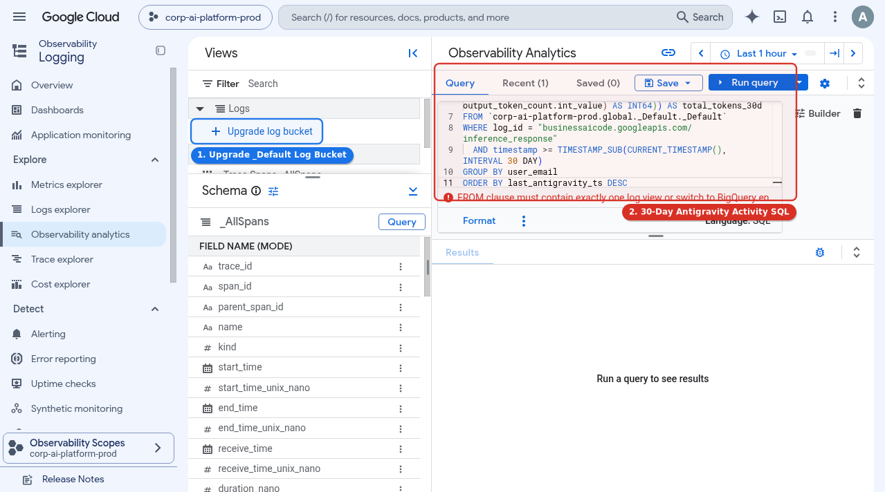

---

### [Part 3 추가 확인 과제 · 선택] 휴직자 Seat 회수 후 복직 시 자산 보존 검증

* 테스트 계정의 `Seat`를 `batchUpdateUserLicenses`로 회수한 뒤 같은 `userPrincipal`로 다시 `Seat`를 할당했을 때 기존 `NotebookLM` 자료와 `Saved Memory`가 그대로 보이는지 확인해 보세요.

---

# [Part 4 · Admin L200] 이중 표면 보안 (Web App 2계층 방어 + Antigravity 실행 통제)

### Step 4-1 & 4-2. `GE Web App` 2계층 민감정보 방어 (`SDP Content Policy` + `Model Armor` 입·출력 분리)

> **설정 시 주요 확인 사항 4가지:**  
> 1. **권한 선행 부여 필수 (`SDP`)**: `Security > Assistant Settings`에서 `SDP Content Policy`를 연결하기 **전에** 반드시 `Discovery Engine Service Agent`(`service-PROJECT_NUMBER@gcp-sa-discoveryengine...`)에 **`roles/dlp.user` 권한을 먼저 부여**해야 합니다. 공식 문서가 정한 사전 요건이며 권한 없이 정책을 연결하면 `File` 첨부가 막힐 수 있습니다.  
> 2. **`Location` 정반대 규칙 주의**: **`SDP Content Policy`는 `GE App`과 동일한 `Location`(예: `global`이면 `global`)** 에 만들어야 목록에 뜨는 반면, **`Model Armor Template`은 `GE App`이 `global`이더라도 반드시 `locations/us` 또는 `eu` Multi-Region** 에 생성해야 합니다.  
> 3. **입·출력 `Template` 분리 (`Model Armor`)**: 정상 답변이 오탐으로 차단되지 않도록 입력용(`Input`)과 출력용(`Output`) `Template`을 분리하고 **출력용에는 `Prompt Injection Filter`를 `DISABLED`로 설정**합니다.  
> 4. **`NotebookLM`은 따로 설정하고 따로 확인**: `Security` 화면에는 `Assistant`용과 `NotebookLM`용 정책 항목이 따로 있습니다. 공식 문서는 `NotebookLM` Upload도 정책 위반 시 차단된다고 설명하면서, 제한 사항에는 `NotebookLM` Upload의 Content Scanning을 지원하지 않는다고 적고 있습니다. 민감 문서를 `NotebookLM`에 올리도록 안내하기 전에 `App 2 (Sandbox)`에서 실제로 차단되는지 확인합니다.

1. 실습 `File` `04_Security_sdp_and_model_armor_setup.sh`의 사전 권한 부여 명령을 먼저 실행합니다:

```bash
gcloud services enable dlp.googleapis.com modelarmor.googleapis.com --project=PROJECT_ID

gcloud projects add-iam-policy-binding PROJECT_ID \
  --member="serviceAccount:service-PROJECT_NUMBER@gcp-sa-discoveryengine.iam.gserviceaccount.com" \
  --role="roles/dlp.user"
```

2. `App` 내부 좌측 **`Security`** 메뉴의 `Sensitive Data Protection configuration`에서 동일 `Location`(`global`)에 만든 `SDP Content Policy`(`KOREA_RRN`, 신용카드번호 등 `BLOCK`, `Microsoft` 민감도 `Label` 지원)를 `Assistant` 항목에 선택하고 **`Save`** 를 클릭합니다.
3. 이어서 좌측 **`Configurations` > `ASSISTANT` `Tab`** 에서 **`Enable Model Armor`** 를 켜고 `locations/us`에 생성된 입력용(`ge-prod-input-guard`)과 출력용(`ge-prod-output-guard`) `Template`의 `Resource name`을 각각 입력하고 저장합니다.

**화면 확인 포인트:** (`① SDP 바인딩 전 roles/dlp.user 선행 부여` → `② Model Armor는 반드시 locations/us(또는 eu) 생성` → `③ 입력/출력 Template 분리 후 저장`)
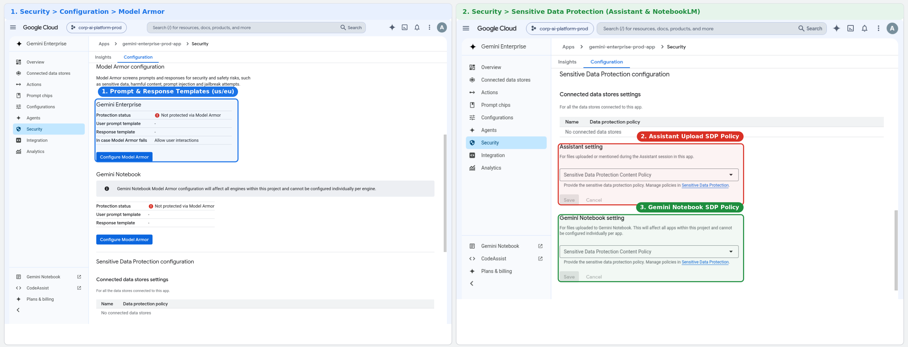

---

### Step 4-3. `Google Antigravity` 실행 보안(`Terminal` · `Sandbox` · `Browser` · `MCP Allowlist`) 및 `Metadata Logging` 켜기

> **핵심 포인트:**  
> `Antigravity`는 개발자 PC에서 로컬 `File` 읽기/쓰기, `Terminal` 명령 실행, `Browser` 제어, `MCP` 도구 호출을 수행하므로 **`Settings > AI developer tools`** 의 초기 기본값 중 <strong>① <code>Terminal auto-execution = Always proceed</code>(승인 없이 자동 실행) → <code>Require review</code>(사전 승인) + <code>Sandbox = ON</code></strong>과 <strong>② <code>Compliance > Metadata logging = Disabled</code> → <code>Enabled</code></strong> 두 가지는 초기 설정 단계에서 바꿉니다.

1. 좌측 메뉴 **`Gemini Enterprise` > `Settings` > `AI DEVELOPER TOOLS` `Tab`** 으로 이동합니다.
2. **`Security`** 섹션에서 아래 4가지 통제 기준을 설정합니다:
   - **`Outside of file access policy`**: **`Deny`** 유지 (지정된 작업 `Folder` 외부의 사내 문서 접근 차단)
   - **`Terminal auto-execution mode` & `Sandbox mode`**: 기본값 `Always proceed`를 **`Require review`**(또는 `Proceed in sandbox`)로 변경하고 **`Sandbox mode = Enabled`** 활성화
   - **`Browser access` & `Allowed URLs`**: 외부 참조 허용 시 공식 기술 문서 `Domain`만 등록하고 `JavaScript auto-execution = Disabled` 유지
   - **`MCP servers` (`Allowed server configuration`)**: 실습 `File` `05_Antigravity_mcp_allowlist_sample.json` 양식처럼 사내 보안 검증을 마친 `Server`만 `mcpServers` 아래 `local_servers` · `remote_servers`에 `id`로 적습니다. 직접 운영하는 Remote `Server`는 `url`도 함께 적습니다:

```json
{
  "mcpServers": {
    "local_servers": [
      {
        "id": "gopls-mcp-server",
        "command": "go",
        "args": ["run", "golang.org/x/tools/gopls@latest", "mcp"]
      }
    ],
    "remote_servers": [
      { "id": "bigquery" },
      { "id": "corp-internal-mcp", "url": "https://mcp.example-corp.com/mcp" }
    ]
  }
}
```

3. 하단 **`Compliance`** 섹션에서 **`Metadata logging`**(기본값 `Disabled`)을 **`Enabled`** 로 바꾸고 저장합니다. 사용자·`Model`별 `Token` 사용량이 `Log`에 기록되어 Step 3-3의 확인과 `Developer tools metrics` 조회에 쓰입니다.

**화면 확인 포인트:** (`① Terminal 실행 정책 Require review + Sandbox ON 상향` → `② 승인된 사내 MCP JSON Allowlist 등록` → `③ Metadata logging = Enabled 전환`)
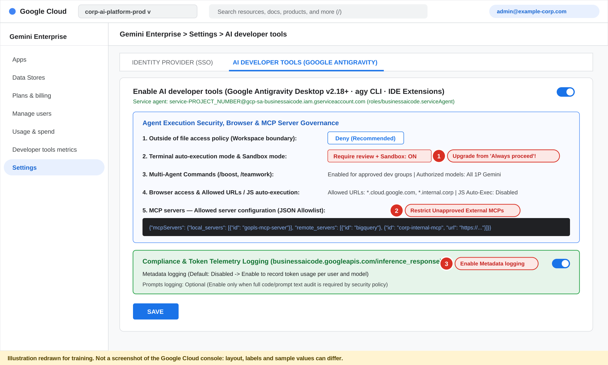

---

### [Part 4 추가 확인 과제 · 선택] 주민등록번호 패턴(`900101-1234567`) 실시간 차단 및 `assistToken` 역추적

* 테스트 문서나 `Prompt`에 모의 주민등록번호(`900101-1234567`)를 넣어 `SDP` / `Model Armor` 실시간 차단 메시지를 확인한 뒤, `Cloud Logging`의 `modelarmor.googleapis.com/SanitizeOperation` `Log`에 찍힌 `client_correlation_id`와 `StreamAssist`의 `assistToken`을 연결해 호출자를 식별하는 절차를 점검해 보세요.

---

# [Part 5 · Admin L200+] 5대 통합 감사 Log · Non-GWS 데이터 확장 · 10대 운영 점검표

### Step 5-1. `GE` + `Antigravity` 5대 감사·`Token` `Log Stream` 누락 방지 및 외부 `SIEM` `Log Sink` 구축하기

> **핵심 포인트:**  
> • 기본 `Assistant` 외에 현업이 제작한 **`No-Code Agent` 및 `Deep Research Agent`는 각 `Agent`의 개별 `Configuration` 탭에서도 `Observability`를 켜야** 사용자 활동 `Log`가 빠짐없이 수집됩니다.  
> • 사내 보안 관제(`SIEM`) 연동 시에는 **사내 인바운드 방화벽을 열지 않아도 되는 `Cloud Pub/Sub` 아웃바운드 `Pull` 구독 방식**을 권장합니다.

1. 실습 `File` `06_Logging_unified_5stream_sink.sh`에 수록된 아래 통합 `Filter`로 **① `GE` 활동(`gemini_enterprise_user_activity`), ② `NotebookLM` 활동(`notebooklm_enterprise_user_activity`), ③ `Antigravity` 추론·`Token`(`businessaicode.googleapis.com%2Finference_response`), ④ 관리자·공유 감사(`cloudaudit.googleapis.com`), ⑤ `Model Armor` 차단(`SanitizeOperation`)** 5대 `Stream` 전체를 단일 `Sink`로 Routing합니다:

```bash
gcloud logging sinks create ge-antigravity-unified-sink \
  pubsub.googleapis.com/projects/PROJECT_ID/topics/ge-security-siem-topic \
  --project=PROJECT_ID \
  --log-filter='logName:("gemini_enterprise_user_activity" OR "notebooklm_enterprise_user_activity" OR "businessaicode.googleapis.com%2Finference_response" OR "cloudaudit.googleapis.com") OR resource.type="modelarmor.googleapis.com/SanitizeOperation"'

# Sink의 Writer Identity가 Topic에 게시할 수 있게 권한 부여
gcloud pubsub topics add-iam-policy-binding ge-security-siem-topic \
  --project=PROJECT_ID \
  --member="$(gcloud logging sinks describe ge-antigravity-unified-sink --project=PROJECT_ID --format='value(writerIdentity)')" \
  --role="roles/pubsub.publisher"
```

---

### Step 5-2. `Non-GWS` 사내 데이터 확장(`Microsoft 365 data store`) · Phase 2 `Agent Gateway` · 비용 조회

> **핵심 포인트:**  
> • **`Microsoft 365` 협업 문서 연결**: 정식 출시(`GA`)된 **`Microsoft 365 data store`** 하나로 `SharePoint` · `OneDrive` · `Outlook` · `Teams`를 함께 연결합니다. 제품별 `Data Store`를 따로 만들 필요가 없습니다(`App 2 Sandbox`에서 `Entra ID + WIF + SCIM` 기반 원본 `ACL` 반영을 먼저 확인).  
> • **Phase 2 특화 `Agent` 통합 주의사항**: 사내에서 따로 만든 `Domain` 특화 `Agent`나 `Multimodal ADK Agent`를 `Agent Registry · Agent Gateway`로 연결할 때, `GE` 기본 `Model Armor`는 외부 `ADK Runtime` 내부를 자동 감싸지 않으므로 **외부 `ADK Agent` Code 내부에도 동일한 `Model Armor`와 `OTel Trace`를 내장**해야 합니다.  
> • **비용 조회**: `Cloud Billing` `Report`에서 `Gemini Enterprise`를 **`Originating products`** Filter로 걸고 `SKU`별로 묶으면 항목별 비용을 볼 수 있습니다. `Antigravity` 사용분이 어떤 `SKU`로 표시되는지는 실제 `Report`에서 확인합니다.

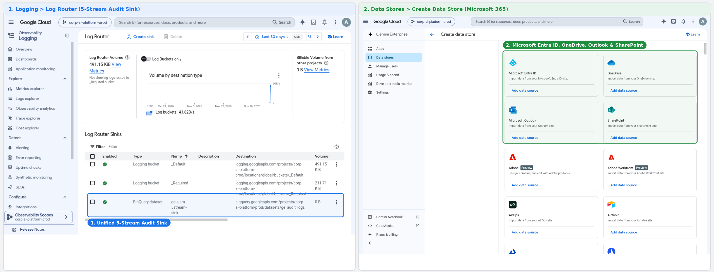

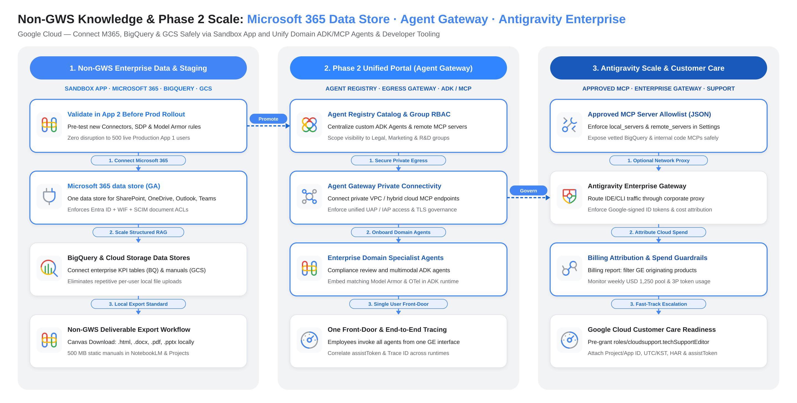

---

### Step 5-3. `[Live 실습 마무리]` 운영 `Google Cloud Console` 10대 필수 점검 `Checklist` & `Customer Care` 지원 기준

실제 운영(또는 검증) `Google Cloud Console` 화면을 함께 열어 아래 **10대 필수 운영 항목**을 하나씩 클릭해 완료 상태를 기록해 보세요(체크 상태는 현재 `Browser`에 자동 저장됩니다).

<div id="interactive-admin-checklist"></div>

> **Google Cloud Customer Care 기술 지원 접수 5대 필수 첨부 기준:**  
> 1. 고객사 및 운영 `Partner` 담당자에게 **`Tech Support Editor` (`roles/cloudsupport.techSupportEditor`)** 사전 부여  
> 2. `Support Case` 등록 시 **① `GCP Project ID / Number`, ② `App ID`(또는 `Antigravity Client` 버전) 및 `Location`, ③ 발생 시각(`UTC / KST`), ④ 민감정보 제거 `Browser HAR File`, ⑤ `Cloud Logging assistToken / Trace ID`** 5대 정보 첨부  
> 3. `Antigravity` 장애 여부는 **`Service Health`의 `Google Antigravity for enterprises`** 항목에서 확인
